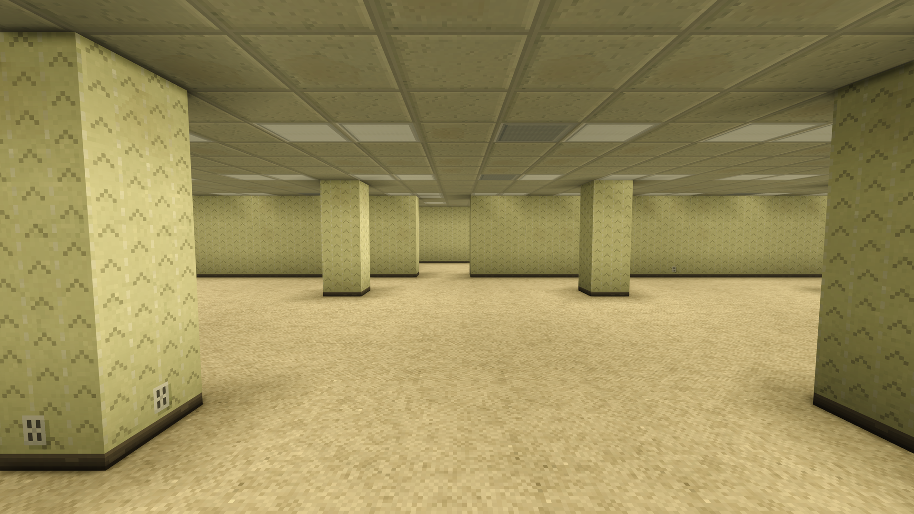

# Backrooms: Survival Story

A [Vintage Story](https://www.vintagestory.at/) mod. **Wake up in the Backrooms with nothing.**



You start in Level 0, an endless, procedurally generated labyrinth of mono-yellow rooms under buzzing fluorescent lights, with a folded note in your pocket and two supply boxes beside you. Walk far enough and it gives way to deeper levels, one after another: the concrete car park of Level 1, the pipe tunnels of Level 2, the Electrical Station, the Abandoned Office, the Terror Hotel, the lightless maze of Level 6, the endless sea of Level 7, the caves of Level 8, the night-time Suburbs and the farmland of Level 10. Further still, reached only by noclipping, lie the Endless City, the Poolrooms, Motion, Level !, Level Fun =), The End, The Hub, Kitty's House, the Neon Paradise and the Courtyard of Windows.

It is a complete survival game built on Vintage Story's own systems. Hunger, temporal stability, knapping, pottery, smelting, farming and animal husbandry all still work; what changes is where everything comes from. You start by cutting a blade from a glass shard, and you end up with a lit home in Level 0, crops under the ceiling lights, copper from the pipes, iron from the caves, and a map of the ways between levels that you drew yourself.

## Features

- **Twenty-two levels**: Levels 0 to 11, the Snackrooms, Level 37, Level 94 and seven far places, each built to follow the Backrooms lore.
- **More than seventy kinds of threshold** between them: elevators, stairwells, pits, pools, vents, windows, barn walls that aren't quite there. Every one always leads to the same place, so you can build a travel network from what you find.
- **Scavenger survival**: salvage furniture, lights and the building itself, then follow Vintage Story's normal path of flint, fire, pottery, copper and bronze with materials found level by level.
- **Level 0 is home**: you only ever wake up there, so everything a base needs has to be brought back.
- **Creatures with their own behaviour**, from Smilers and Hounds to the Mangled. They're heard and glimpsed far more than fought, and each one has a counter you can learn.
- **A map that only shows what you have seen**, and remembers it.
- **Wanderers' notes and a journal**, a handbook rewritten for the Backrooms, and a First Steps tutorial.
- **World settings** for creature activity, resource scarcity, the map (down to no map at all) and the size of the levels.

## Installing

1. Requires **Vintage Story 1.22** or later.
2. Download the mod from [its page on the Vintage Story mod database](https://mods.vintagestory.at/show/mod/73380), or build it yourself (see below). Put the zip in your `Mods` folder without unpacking it.
3. Create a new world and pick the **Backrooms: Survival Story** playstyle. Under *Survival challenges* you can set **Backrooms entities** (Off, Low, Normal, High), **Backrooms scarcity** (Plentiful, Normal, Sparse, Scarce) and **Backrooms map** (Seen areas, Seen areas with no waypoints, None). Under *World generation* there is also **Backrooms level size** (50% to 200%, how wide the rings of levels are).

The mod only affects worlds created with its playstyle. Your other worlds are untouched.

**Multiplayer:** the server and every player need the same build. The mod compares builds when a player joins and warns both sides in chat if they differ.

**Updating:** a world keeps the layout it was created with, so updating the mod never changes the parts of an existing world that are already generated, or what new chunks will hold.

## Documentation

- **[Player guide](docs/GUIDE.md)**: every system and every level in detail. It's full of spoilers; the in-game handbook (H) tells you enough to survive.
- **[Developing](docs/DEVELOPING.md)**: building, the code map, debug and cheat commands, and the scripts that generate the assets.
- **[Design notes](docs/design/README.md)**: the plans and research the mod was built from.

## Building from source

You need the [.NET 10 SDK](https://dotnet.microsoft.com/download) and Vintage Story 1.22 installed.

```sh
dotnet build                 # → bin/Debug/Mods/backroomsss/
dotnet build -c Release      # also writes bin/backroomsss_<version>.zip
```

The build looks for the game in `%APPDATA%\Vintagestory`. If yours lives elsewhere, set the `VINTAGE_STORY` environment variable to its folder. To run the game with the mod: `Vintagestory.exe --addModPath "<repo>/bin/Debug/Mods"`. See [DEVELOPING.md](docs/DEVELOPING.md) for the rest.

## License

- **Code** (`src/`, `tools/`, the project files) is licensed under the [GNU General Public License v3.0](LICENSE).
- **Content** (everything under `assets/` except as noted below, the documentation in `docs/`, and `modicon.png`) is licensed under [Creative Commons Attribution-ShareAlike 4.0](LICENSE-CONTENT) (CC BY-SA 4.0). Much of it adapts text and ideas from the Backrooms wikis (see Credits), which are licensed under CC BY-SA 3.0. Their ShareAlike terms carry over, and CC BY-SA 4.0 is a compatible later version.
- **Vintage Story's own files** remain the property of Anego Studios. Where an asset is a copy or adaptation of one of the game's asset files (for example an entity definition based on a vanilla one), the game's terms apply to those parts. The mod references the game's textures, shapes and sounds by name rather than including them.

## Credits

Made by eXception386.

The Backrooms are a collaborative creation that began with an anonymous post on 4chan's /x/ board in May 2019. The levels, entities and their descriptions follow the work of the Backrooms community, adapted under CC BY-SA:

- [The Backrooms Wikidot wiki](http://backrooms-wiki.wikidot.com/) is the main source: the levels, Level 0's zones, the entities and the M.E.G. Authors of each page are listed in its history.
- [The Backrooms Fandom wiki](https://backrooms.fandom.com/), its [Miraheze mirror](https://backrooms.miraheze.org/) and the [Escape the Backrooms wiki](https://escapethebackrooms.fandom.com/) are second sources, especially for Level !, Level Fun =), The End, The Hub, Level 974, Level 3999 and Level 188.
- Kane Parsons' (Kane Pixels) Backrooms films inspired Level 0's look and feel. No footage, images or sounds from them are used.

All textures, models and sounds in the mod were made for it, mostly by the generator scripts in `tools/`.

*Backrooms: Survival Story is a fan work. It isn't affiliated with Anego Studios, Kane Parsons, A24, or any of the wikis above.*
