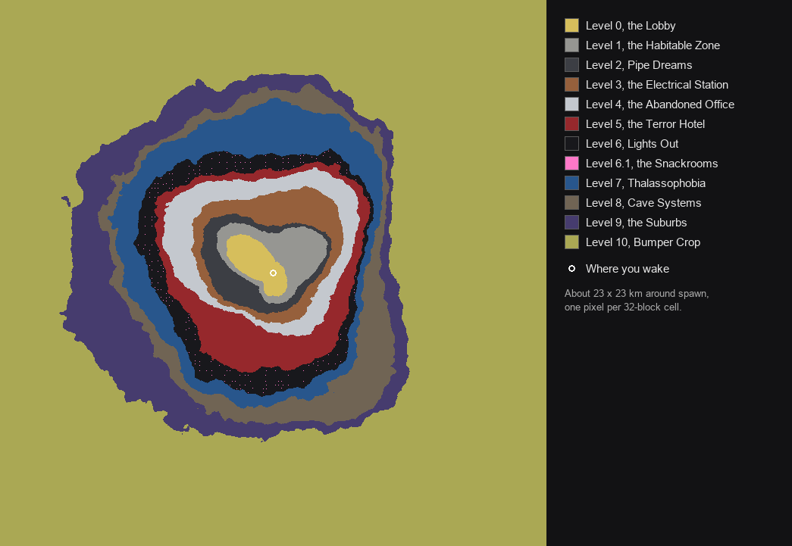

# The Backrooms (Vintage Story mod)

Wake up in the Backrooms with nothing. You start in Level 0, an endless, procedurally generated expanse of mono-yellow rooms under buzzing fluorescent lights. Walk far enough and it gives way to deeper levels, one after another: the concrete car park of Level 1, the pipe tunnels of Level 2, the Electrical Station, the Abandoned Office and the Terror Hotel. Beyond them are the lightless maze of Level 6, the endless sea of Level 7, the caves of Level 8, the night-time Suburbs of Level 9 and the farmland of Level 10. Further still, reached only by noclipping, lies Level 11, the Endless City; and more places no ring reaches: Level 37, the white-tiled Poolrooms; Level 94, a stop-motion world of round green hills; Level !, a hospital hallway you run down with a horde behind you; Level Fun =), an endless party where the guests are not people; The End, a library that looks like the way out; The Hub, a crossroads of tunnels lined with locked doors to every level; Level 974, Kitty's House, where something takes you if you carry something cute; Level 3999, the Neon Paradise, an endless arcade-mall of tickets and prizes with a dark fringe; and Level 188, a courtyard walled in by a hotel's windows, some of which show other places. Scavenge supply boxes and crates for Almond Water, food and basic materials.

Each deeper level opens up a different way to survive: darkness and navigation in Level 6, water in Level 7, geology and mining in Level 8, scavenging in Level 9 and farming in Level 10. Level 37 is where to recover (and where people drown), Level 94 where to stock up (if you are indoors by nightfall).

Targets Vintage Story 1.22 (.NET 10).

*About 1,300×1,300 blocks around spawn, from the centre outwards: Level 0 (yellow), Level 1 (grey), Level 2 (dark), Level 3 (brown and brick red), Level 4 (light grey), and Level 5 (red), which has tan lobbies and boiler halls.*

## Playing

Create a new world and pick the **The Backrooms** playstyle. It only affects worlds created with that playstyle. Normal worlds are untouched.

- **Map (M / F6):** the map only shows what you have actually seen. It reveals the area around you along your line of sight, so walls block it. Explored areas are remembered between sessions, so you can find your way back.
- **Handbook (H):** in a Backrooms world the Guides tab is rewritten for the Backrooms, in the voice of the vanilla guides. The Starter Guide, the Progression Guide and Reality Stability replace their vanilla pages; eight pages are added after the Progression Guide (Home and Expeditions, Finding the Way, Salvage, Food, Heat and Cold, The Levels: 0 to 11, The Levels: Beyond the Rings, Ways Between Levels, What Lives Here); and every other vanilla guide (knapping, farming, smelting, steelmaking…) keeps its text but opens with an "In the Backrooms" preface saying what is different here. Text in `tools/gen_guide.py`, wiring in `src/GuideSystem.cs`. Other worlds keep the vanilla handbook.
- **Tutorial:** the Tutorials tab holds *Backrooms: First Steps* (`src/Tutorial/BackroomsTutorial.cs`), a 15-step quick start on the game's own tutorial system (read the pocket note, open the boxes, glass, cutting, shiv, bags, flint, knife, map, handbook) that replaces the vanilla First Steps in Backrooms worlds and starts by itself the first time a client joins one (`.tutorial hud` hides it; progress is kept per client in `ModConfig/tutorial-tutorial-backrooms-firststeps.json`).
- **Starting waypoint:** "Where I woke up" marks your starting point.
- **Your own waypoints:** right-click the map to add one.
- **Waypoints made for you:** every gate you walk through, and every elevator, stairwell, door or pit you take (with the way back, where there is one), is marked on your map the first time. Reading a wanderer's note marks the place it tells of.
- **Notes and the journal (J):** wanderers' notes say what earlier wanderers learned, in order, and every note read is kept in your journal (see *Notes and the journal* below).
- **Dark areas** are easier to explore with a candle.
- **Arriving in a level** shows its name, with a word of advice for the dangerous ones.
- **Surveyor's chalk** (sometimes found in crumbled ceiling tiles, or crafted from a vanilla chalk stone) marks walls with an arrow, a cross or a circle. Choose the mark with the tool mode key (F), and click a mark again to change it. Chalk marks show bright white on the map.

## Surviving

### Home and expeditions

The Backrooms are survived from a home, in expeditions; the design is in `docs/survival-loop-plan.md`.

- **You only ever wake up in Level 0.** Die anywhere and you wake in the Lobby, and what you carried stays where you fell. A temporal gear still moves where you wake, but only within Level 0; elsewhere it will not take hold and is not used up (`src/Reality/AnchorSystem.cs`). Everything a home needs (a door, a chest, fire, seeds, soil) has to be brought back from deeper levels.
- **The walls between levels are solid, but for gates.** A gate (a doorway through) comes every few hundred blocks along a boundary. Chalk arrows on the walls nearby point the way to one, and wanderers' notes tell of them. Walking the wall looking for one is walking the most dangerous ground of a level.
- **Food is scarce.** Most supply boxes and crates were gone through long ago: a torn box or an emptied crate can be told from across the room and never holds food. Level 0's boxes were left in twos and threes in the corners of rooms, about one cell in nine (one in four or five in the blackouts), plus the caches at the hearts of dens. The deeper the level, the less is picked over; rooms behind locked doors and the hearts of dens were never touched. Hunger runs at 125%.
- **Heat and cold.** From 30 °C up you go hungry faster, up to half again as fast (Levels 2 and 3, the boiler halls). Levels 6 and 8 are cold enough to want clothes. Level 0's blackout zones are cold and damp, so food keeps there.
- **Farming at home.** Crops grow in Level 0 under the ceiling lights (light 15 under a working troffer gives about 60% of daylight growth) on soil from potted plants, watered from a flooded room or a bucket. Seed packets come from Level 9's sheds and kitchens and, rarely, supply boxes.

| New | What it is | Where |
|---|---|---|
| Wanderer's note | Right-click to read: the next note due in your own sequence, kept in your journal; it marks the nearest gate, way out, sealed cache or refuge on your map, by its paper. Used up when read | Supply boxes, torn boxes, desks, filing cabinets, writing desks, tents, bedrolls, lost backpacks; lying loose at dens, the Manila Room, Red Rooms, chalk-crossed dead ends, Sanctums, the Beverly Room, food courts, Level !'s start rooms; one in every new player's pocket |
| Folded note | The rare paper: more exact information (routes, odds, rules), marked from twice as far | Deep caches, den hearts, Red Rooms, rooms behind locked doors, lost backpacks, bedrolls, tents, runners' remains, the far edge of a ring |
| Pry bar (24 uses) | Hold right-click on a locked door for 4 s: it gives for good if there is a room behind it, and everything near hears | 2 metal brackets + iron nails and strips; tool shelves, toolboxes, workbenches |
| Seed packet | 4 vanilla seeds, opened in the crafting grid | Tool shelves, kitchen cupboards, now and then a supply box |
| Torn supply box, emptied crate | Picked over: scraps and boards, no food | Three in four boxes and crates in Levels 0 and 1, fewer deeper |

### Notes and the journal

The design is in `docs/notes-plan.md`; every text is listed in `docs/notes-catalogue.md` (generated by `tools/gen_notes.py`).

- **A note is blank until it is read.** What it says is the next entry due in that player's own sequence: the first note anyone reads is always the same, and **the series comes in order**. After the first three, notes alternate between *The Wanderer's Way* (25 entries carrying a player from waking to the far levels, some waiting until you have been somewhere) and the track of the level the note is read in (one per level, 3 to 9 entries, Levels 0 to 188).
- **A cast of writers** carries them: Dez the scavenger, A. Lindqvist the surveyor, M.E.G. Field Team 9 (their count falls from six to one), Tom writing to his wife Ruth, Nell the grower, and many one-off hands.
- **Folded notes** (a rarer paper) give the next entry of the level's rare track, then of a general one: exact routes, odds and rules. **Scraps** of flavour come when the tracks run dry; after everything, a note is just its map mark.
- **Map marks:** every note marks by its paper (door, way, cache, refuge); some entries also mark a place of their own (the Manila Room, a den, a manhole, the barn wall, an EXIT door that opens, a Hub entrance, a Red Room).
- **The journal** (J, or `.journal`) keeps every note read, per player on the server (it survives death and relog): The Wanderer's Way, the levels in order, Folded notes, Scraps, Directions; each with where and when it was read, and *Show on map* / *Mark again*.
- Code in `src/Notes/` (`NoteSequencer` is pure, shared with the harness's `notes` mode); debug with `/backrooms note read|give|probe|log|status|reset`.

### You are a scavenger

What you take is mostly salvage. The building itself can be broken (to shape a home, or to cut a way through), but it breaks *down*, never into blocks you can set up again; and where it holds the levels apart it does not break at all.

- **The building breaks with the tool its material calls for, into scraps** (`src/Salvage/Breakdown.cs`):
  - Drywall, plaster and wallpaper (Levels 0, 4, 5, the houses): any tool, an axe best; bare hands at a seventh of the pace. Mostly dust; now and then a stick or a wallpaper strip.
  - Boards, panelling, floorboards and roofs: the same. Sticks, a little firewood, rarely a plank.
  - Concrete, brick, tile, marble and every floor slab: a copper pickaxe, like rock. **Rubble**; carpeted floors a few carpet fibres. Four rubble make a block of **rubble masonry** to build with.
  - Pipes, railings, poles and machinery: a copper pickaxe. Metal brackets, a little scrap wire from anything wired, now and then a copper or lead bit from pipes.
  - Glass: anything. Glass shards.
  - Vanilla rock and ore (Level 8, the cliffs) and soil break as in any world.
- The walls between levels break like any other wall of their material: the gates are the easy way through, not the only one.
- **Never broken** (`src/Salvage/Protection.cs`; the block info says so):
  - Each level's roof: from its ordinary ceiling height up to the mantle cap, the blocks with nothing open above them. Level 0's ceiling tiles and crawlspace can come down; the slab over the crawlspace cannot. On a level with one plain ceiling, that ceiling is the roof. None under the open sky.
  - The wall between two levels from the lower of their roof heights up (below that it breaks like any wall of its kind, so it can be broken through or tunnelled under).
  - Doors, elevators, vents, thin spots, vending machines, fountains and other dispensers, and landmarks.
- Lights, lit or dead, break for glass shards, a bracket and some wire. Wrecked cars break with a copper pickaxe, the whole car at once, for brackets, wire, glass and a little copper.
- **The ground is vanilla's** (`src/Worldgen/UndergroundSystem.cs`): under every floor are 8 blocks of concrete (`WorldGenerator.FoundationDepth`), then the ground Vintage Story lays down in any world, from its own generators: the shape of the land (with its sea level put at the floor), rock strata, caves, and ore, coal, minerals and gems. Where the land lay lower than the foundations it is filled up with its own rock; where it rose higher the levels replace it. Nothing of the surface is borrowed (no soil, plants, trees, ruins or story structures), nor the soil deposits (clay, peat, gravel), which would break out in the open levels' lawns and fields. `/backrooms ground x z` counts what lies under a chunk. Worlds started before this change keep plain concrete in the chunks already generated.

- **Loose objects break as normal:** supply boxes, crates, furniture, ceiling tiles and dead light fixtures.
  - Dead fixtures give glass shards, and sometimes a bracket or wire.
  - Ceiling tiles mostly give nothing, but the void above sometimes hides scrap wire, a metal bracket or rotten wood.
- **Walls and carpet can be cut:** right-click papered walls or carpet with a blade to cut away wallpaper strips or carpet fibres. The wall or floor stays, visibly bare.
  - A glass shard works as a blade, but may snap each time.

| Make | From |
|---|---|
| Glass shiv (a knife) | glass shard + wallpaper strip + carpet fibres |
| Improvised scraper (a tougher knife) | metal bracket + wallpaper strip + 2 carpet fibres |
| Twine | 3 carpet fibres |
| Carpet bag (3 slots, like a hand basket) | 5 carpet fibres + twine |
| Dry grass (tinder) | 2 wallpaper strips |
| 2 sticks | rotten wood |
| Firewood | 2 rotten wood |
| Firewood | 3 planks + an axe |
| 2 sticks | a plank + a knife |
| Nails and strips | 2 metal brackets |

With tinder, sticks and firewood, the vanilla fire starter, firepit and torches work as usual.

### A Vintage Story player wakes in the Backrooms

Breaking things down feeds Vintage Story's own progression, so the usual path from knapped flint to bronze still works. What changes is where each material comes from.

- **Level 0 (the Lobby):** wanderers' supply boxes hold flint, sticks and dry grass. Knap a flint knife and axe, then make a fire starter, torches and a firepit. Furniture breaks into planks, sticks and nails, so a chest or a barrel is possible before you own a saw.
- **Level 1:** the crumbling concrete leaves loose stones and flint about. Crates and shelves hold sticks, tinder, flint, charcoal and brackets.
- **Levels 2 and 3:** cable drums, pipe stacks, fans and machine cabinets give copper and lead bits. Scrap wire smelts to copper. The flooded tunnel under Level 3 is floored with clay for pottery, moulds and a crucible. The generator rooms have coal heaped beside them, enough to smelt with.
- **Level 4:** office furniture gives lumber and paper. Fridges hold fruit and cheese. Toolboxes sometimes hold a copper hammer, chisel, saw or knife. Storerooms sometimes hide a supply box.
- **Level 5:** coal piles in the boiler halls. The beds come away as real beds you can sleep in. Wardrobes and suitcases hold clothes. Dining tables, curio cabinets and service trolleys give silver; luggage carts, ashtray stands and chandeliers give brass (candelabras stand in Level 3's Sanctums and the city).
- **Level 7:** driftwood is firewood, and the sea has fish.
- **Level 8:** real ore veins (copper, tin, zinc, bismuth, iron, gold, lead, sulfur, coal…; no silver) run through the strata, with loose ores and stones on the cave floors and clay in places. Limestone and chalk grind to lime, and halite grinds to salt.
- **Level 9:** houses to strip, wardrobes and dressers of clothes, berry bushes gone wild in the gardens, and wildlife: hares, foxes and raccoons.
- **Level 10:** crops ready to harvest, livestock in the paddocks, cattails at the ponds and clay in their beds, bee skeps for honey and wax, and an old quern in the barns.
- **Level 37:** Epsom salt for poultices; somewhere to heal.
- **Level 94:** the ground can be dug: its turf gives poor soil, the modelling clay under it gives red clay (with a layer of blue clay a little way down), enough for all the pottery you want, and five to seven blocks under the turf run seams of **fire clay** (`rawclay-fire`, three deep, over about half the hills): the Backrooms' only fire clay, and so the only road to fire bricks, the bloomery, iron and steel. Iceboxes, Almond Milk and fountains of Almond Water feed you while you are there.
- **Level !:** a test of food, armour weight and nerve rather than a place to gather: sprinting is the only answer (armour slows you, and the horde with you). Energy Bars give a second wind; caught, you lose everything you carried.
- **Level Fun:** the richest larder, guarded: cakes, cookies, pumpkins, gifts of wanderers' gear, linen from tablecloths. Poultices and bandages answer the Partygoers' bite; fire keeps them off.
- **The End:** no food, but the furniture of a home (vanilla chairs, tables, ladders, shelves), paper and books, some of them written in.
- **The Hub:** cold (6 °C, so clothes) and foodless, but safe, and Level Keys turn it into a way back to levels you have earned.
- **Level 974:** a real bed, water from the taps, a fridge and pantry that refill, and Kitty's dresser of clothes.
- **Level 3999:** a daily income of tickets (once per machine per day, 40 a day) for prizes up to a temporal gear; tray meals; vending machines that turn Almond Water into food; salvage that feeds the crucible (circuit boards to copper, coin mechanisms to brass) and the furnace (plastic), and neon lamps to craft.
- **Level 188:** clothes, cloth and linen from the rooms; a little breakfast; mostly a junction, read from its windows.

Some limits:

- The Level 10 crops grow in old, exhausted farmland, so seeds planted back in it will not grow. Hoe fresh soil instead.
- Temporal gears are very rare: a supply box gives one about once in a hundred.

### Reality Stability

The gear on the HUD shows how firmly you are anchored. It is Vintage Story's temporal stability, with the Backrooms' own geography.

- **Each area has its own stability.** Where it is low the gear turns backwards and your stability drains. When yours is low the world distorts, and at zero you take damage.
  - Kind places: the Manila Room, the Level 1 car park, all of Level 4, the Beverly Room, Level !'s Safe Zone, The End's central hall, the Hub, Kitty's House for its first 18 hours, Level 3999 wherever its neon is lit (the lobbies most), and Level 188's guest rooms.
  - Bad places: Level 0's blackout zones and above all its Red Rooms, Level 2, Level 3 (worst in its flooded tunnels), the hotel corridors and above all the boiler halls, Level ! outside the Safe Zone, all of Level Fun (and its Party Fever lowers your cap), The End away from its middle and after two hours there, Kitty's House after 18 hours, Level 3999's failing neon and its Neon Blackout (3999.1), Level 188's corridors, courtyard and roof (most of all near a beckoning window).
- **Almond Water** restores some stability when you drink it.
- **Reality Shifts:** about once every 30 in-game hours the lights fail for a few hours. Everything beyond a few steps is lost in black, and stability drains everywhere.

### Things that live here

The Backrooms are not empty, but what lives in them is there to be heard and glimpsed far more than fought. The full player-facing guide is the handbook page *What Lives Here*; the design is in `docs/entity-plan.md`.

- **Danger rises towards the edge of each level.** In the heart of a level you hear things down the hall and see things far off that leave when you come near. Further out, things follow at a distance. Near the edge into the next level, and near its elevators, stairs, pits and noclip walls, they hunt.
- **They come bolder** when you stand in the dark, when your Reality Stability is low, when you run, and during a Reality Shift. After a close call you are left alone for a minute and a half.
- **Exposure:** the longer you are out without resting, the bolder they come (up to +0.3 menace after ten in-game hours). Resting is a minute by a lit firepit or burning Firesalt, beside a wanderer, in a safe place, asleep in a bed, or at home (within 48 blocks of where you wake, in Level 0).
- **Noise:** breaking something open, forcing a door and running all carry. Noise adds to the menace and dies away over half a minute.
- **Dens:** about one cell in seventeen on the dangerous levels (one in four of Level 0's blackout cells) is a den: a Hound pack over a pile of bones, a Deathmoth hive, a rat warren, a Skin-Stealer's lair, or a Smiler's dark. Within 18 blocks of its heart a den is as dangerous as a level's edge, and what lives there is what comes. Chalk crosses on the walls round it warn you off; two or three sealed boxes sit at its heart.
- **At the edge**, hunters are put down between you and the gate you are heading for, and anything stalking you gives chase once you run.
- **Level 0** stays empty but in a Reality Shift, when Smilers watch even its heart from the dark.
- **Safe places:** the Manila Room, Level 3's Sanctums, the Beverly Room, the Snackrooms, the 9th Road and its camps, the Hub, Kitty's House, The End (but for Smiler glimpses in its collapses), Level 3999 outside its Blackout, a Level 188 guest room with its door shut. Level 4's heart and Level 10's fields are calm. In Level 11 nothing attacks unless provoked.
- **Every entity has a counter you earn as you go:**

| Entity | Where | What it does | What keeps it back |
| --- | --- | --- | --- |
| Smiler | Dark places: Level 0's blackouts and Red Rooms, Levels 1–3, 6, 8, 9 | Eyes and a grin in the dark; cannot be killed | Light of 8 or more (a torch, not a candle); holding its gaze without running |
| Hound | Levels 0 (edge), 1–5, 8–10; passive in the city | Packs of 2–3, heard before seen; some starved, a rare old one tougher | Fire (lit firepits, Firesalt); light slows them; a steady stare holds one back for a few seconds before it breaks and comes on; weapons and armour |
| Faceling | Levels 1, 3, 4, 5, 9, 11, the Snackrooms; children in 5, 9, 11 | Seldom met. Wanders, sits, its blank face turning to follow you; right-click one and it waves, then points toward the nearest way out | Harmless unless hurt, and then every Faceling near turns on you. Hurrying away means Hounds are near |
| Deathmoth | Levels 1, 5, 9 | Circles open flame; settles on floors and tables; males drink at puddles and bodies; females bite near the edge | Candle draws few, a closed lantern none; smoke scatters them. Don't go at a settled female: she rears, and calls every female near |
| Skin-Stealer | Levels 1–3, 5, 9 | Slow and strong; coughs and calls out from out of sight | Distance, doors, fire |
| Duller | Levels 3, 4, 6, 8, the subway | Scrapes inside the walls; reaches through them at people passing close by, sometimes taking something from your hotbar (it is dropped wherever the Duller goes) | Almond Water (5 minutes after a drink, or standing near a fountain or seep), facing it, keeping off the walls |
| Death Rat | Levels 1, 2, 8, 9, the city's alleys | Packs that nip at your legs; horn tips glow faintly red in the dark; hairless in Level 2. Rarely, the Screaming: the lights fail and a pack goes past at a run | A carried torch, fire. Edible |
| Clump | Levels 2, 3, by Level 10's noclip barns | Buried with one arm out of the floor; wakes when you come close, or crawls after noise; grabs, feeds, buries itself again | Watching the floor; walking round; staying quiet |
| The Thing | Level 7, below the twilight zone | Circles divers far out; strikes once at one who stays deep too long with low stability, or anyone in the abyss | Surfacing |
| The Mangled | Level 9, rarely (far likelier in a Reality Shift) | An event: the air goes cold and a grey fog rolls in, voices call out of it, then a pillar of faces three times your height walks the streets; its tendrils lift you into the dark and drop you. Cannot be killed; striking it makes it stay longer | Indoors (it is too big for doors), waiting the three minutes out (`/backrooms mangled` brings it on, for testing) |
| The horde | Level ! | Hounds, Skin-Stealers, Smilers, rats and moths running at nearly your sprint: a front that falls back while you sprint and catches whoever stops; caught is death. Puppets of the chase (`RunChase`), worth nothing killed | Not stopping; the Safe Zone |
| Partygoer | Level Fun | Slow, nearsighted packs at the parties; a latch that turns to Party Fever unless treated within 30 s (three bites' worth and you join the party, guarded by a new one with a red balloon); claws once its chest opens below half health | Running, doors, fire; a poultice or bandage after a latch; a party hat and a red balloon as a disguise beyond 3 blocks |
| Carnivorous Balloon | Level Fun's dark corridors | A balloon tied to nothing: stings and holds you on touch; gasses when popped | Not touching it; poking it from out of reach |
| Kitty | Level 974 | Three metres tall and faceless; appears where you are not looking, watches, never harms. Takes the cute thing you brought and sends you to sleep (`L974System`) | Good manners: breaking its things or striking it puts the lights out for a day |
| The Keymaster | The Hub's Tower | Invulnerable; gives one Level Key of a level you have been to and escorts you to its door; throws out anyone who breaks something | Nothing needed |
| Arcade Attendant | Level 3999's prize counters, food stalls and lobby desks | Faceless and polite, put down while anyone is near and never saved; invulnerable; right-click and it points the way to a lobby (`BackroomsAttendant`) | Nothing needed |
| Smilers, Hounds, Partygoers | Level 3999.1, the Neon Blackout | The only danger in Level 3999: its dark fringe has the Threshold band | Light, fire; staying in the lit mall |
| The Windows | Level 188, about one room in sixteen, moving each in-game day | A figure beckons in a lit window; whispers within 6 blocks; within 2 for a second an arm (`l188-arm`) comes out of the glass, holds, hurts and drags; six seconds at the glass is death | Two blows on the arm, or 3.5 blocks away; reading the windows and staying out of those rooms |
| Peripherals | Level 188's corridors and courtyard | A shape at the edge of the screen (client HUD), gone when you turn to it; −0.02 stability each | Nothing; they only unsettle |
| Skin-Stealer, Smiler | Level 188 (upper corridors; the dark) | Light encounters (weights 0.5 and 0.6) | As elsewhere; a shut guest-room door |

- **Flickerings:** out towards the edge of Level 1 the lights of a section sometimes fail for a minute or two, and a pack of Hounds hunts you until they return (`/backrooms flicker` starts one).
- **Wanderers** who trade keep to camps in Level 1, outposts in Level 4, the 9th Road and the city, about one every kilometre or two of travel: the vanilla trader (right-click to talk, then ask to trade), who never fights back, with a Backrooms trade list (salvage and hides bought; Almond Water, Firesalt, candles, bandages, seeds sold, for rusty gears). Nothing hostile closes in on someone beside one.
- **Firesalt** is found in the coal heaped by Level 3's generators and Level 5's boilers, and from Level 8 can be made (salt + powdered sulfur = 2). Set down, it burns for half a day and nothing hostile comes within about 8 blocks.
- **Entities are never kept with the world.** They are put down out of sight for one player and despawn once they leave.
- **World settings** under Survival challenges when creating a world: *Backrooms entities* (Off: sounds only, Low, Normal, High) and *Backrooms scarcity* (Plentiful: twice the food, Normal, Sparse: 0.6 times the food in every box, crate, cupboard and fridge).

### The topology lies

The rings are only how the world is built; the network of ways between the levels is the real map. It follows two rules, so you can learn it, mark it on your map and build routes out of what you have found.

**Every threshold always leads to the same place.** Where it leads is fixed the first time anyone goes through it, and saved with the world. A threshold is one thing however big it is: both halves of a gate, every step of a stairwell and every part of a lake's bottom lead to the same spot.

**If you walked through it, you can walk back. If you fell, dived or were taken, you cannot.**

- **Two-way thresholds with a partner:** an elevator arrives beside another elevator, a stairwell beside another stairwell, a door beside a locked door. That partner becomes the way back, whatever it would have led to otherwise. Go through it and you come out where you left.
- **Two-way thresholds without a partner** leave a **thin spot** where they put you down: a pale, wavering seam in the air that hums like a translocator. Right-click it to step back through. It stays there for good.
- **One-way thresholds** drop you somewhere fixed, with no way back from there.

This is how Vintage Story's own translocators behave: a repaired one picks its exit once, a partner appears at the far end, and the pair is fixed from then on.

| From | Threshold | To | Way back |
|---|---|---|---|
| Levels 3, 4, 5 | An elevator (everyone standing in the car rides along) | Another elevator in Level 3, 4 or 5; from the hotel, now and then Level 1 | The elevator you arrive beside (in Level 1, a thin spot) |
| Level 1 | Climbing a stairwell | Another stairwell in Level 1, or now and then in Level 4 | The stairwell you arrive beside |
| Level 4 | Climbing a stairwell | Another stairwell on the same floor, or now and then Level 0 | That stairwell (in Level 0, a thin spot) |
| Level 5 | A hotel door: most are locked for good, a few open | Another part of the hotel, Level 3 or Level 0 | The hotel door you arrive beside, which now opens (elsewhere, a thin spot) |
| Level 5 | Climbing the staff stairs behind an open door under a STAFF sign | Level 6 | Thin spot |
| Level 2 | A steel door in a tunnel wall: most are locked, some open | Level 3, Level 4 or Level 1 | Thin spot |
| Level 8 | A vent beside the 9th Road | Level 2 | Thin spot |
| Level 9 | The gate at the end of a field behind the houses | Level 10 | Thin spot |
| Level 10 | Walking into a stretch of barn wall that isn't quite there (in some barns, on the east wall between the stalls) | Level 11, the Endless City | Thin spot |
| Level 11 | An office tower's elevators / a hotel's elevators | Level 4 / Level 5 | The elevator you arrive beside |
| Level 11 | A rowhouse's front door | Level 9 | The locked front door you arrive beside, which now opens |
| Level 11 | A diner's kitchen door | Level 6.1 | The kitchen door you arrive beside in the food court |
| Level 11 | An apartment block's basement door / a substation's steel door / a subway maintenance door | Level 0 / Level 3 / Level 2 | Thin spot |
| Level 11 | A parking garage's ramp down / a dark doorway off an alley / standing in a patch of wheat in a park | Level 1 / Level 6 / Level 10 | Thin spot |
| Level 5, Level 11 | A cyan door marked POOL (now and then one of the hotel's locked doors; the city's public baths) | Level 37, out of one of its own POOL doors | The POOL door you arrive beside |
| Level 37 | A POOL door | A corridor of Level 5, beside a locked guest door | That hotel door, which now opens |
| Level 37 | Walking on along a dry corridor whose tile gives way to office carpet | Level 4 | Thin spot |
| Level 37 | Walking into the black round mouth at the end of a tunnel of tiled arches | Level 7, on a ledge over the sea | Thin spot |
| Level 11 | Walking into the screen of a cinema (midtown) | Level 94: you fall out of the sky over the hills and land softly | Thin spot |
| Level 9 | The front door of a doll's house (one in a hundred and fifty, too cream and too clean) | A house's front door on the hills of Level 94 | That door |
| Level 94 | The front door of one house in forty | Level 9, out of a locked front door | That door, which now opens |
| Level 94 | A rusted gate with no sign on a hilltop, at twilight (dusk and dawn) only | Level 10 | Thin spot |
| Level 0 | Falling into a pit | Level 2 | None |
| Level 4 | Pressing the buttons of one of the few hungry vending machines (it takes you every time) | Level 6.1, the Snackrooms | None |
| Level 6 | A wire strung low across a corridor | Level 6.1 | None |
| Level 6 | Stairs down in a chamber, where you can hear waves | An entry room in the ceiling of Level 7, over the sea | None |
| Level 6.1 | Rusty doors / glass doors / kitchen doors / vents (they shut behind you) | Level 6 / Level 4 or 5 / another food court / Level 3 | None |
| Level 7 | Diving into the circle of standing stones / swimming into a cave mouth in the deep | Level 9 / the 9th Road in Level 8 | None |
| Level 10 | Diving to the bottom of a lake | Level 7 | None |
| Level 11 | Falling into an open manhole / a street that has caved in | Level 2 / Level 8 | None |
| Level 11 | Diving into the deep middle of a park fountain | Level 7 | None |
| Level 7 | Diving to a patch of white tile on the seabed in the twilight zone, faintly lit | Level 37 | None |
| Level 9 | Diving to the bottom of the one backyard pool in a few dozen that is still full, lit teal | Level 37 | None |
| Level 37 | Sinking to the bottom of a pit nobody has found the bottom of | A backyard pool in Level 9 | None |
| Level 94 | Opening the door of a house full of water | Level 7 | None |
| Level 94 | Winning the King's trial | Level 1, Level 4, or back to a town in Level 94 (fixed by the King's table) | None |
| Level 1 | Stairs into the ceiling with confetti on the steps (one stair core in twenty) | Level Fun's service stairs | Those stairs |
| Level 5 | Wooden double doors with big letters F-U-N (one locked room in 150) | Level Fun's FUN doors | Those doors |
| Level 11 | Gym doors painted with a tiger, a parrot and a giraffe, at the back of a parking garage | A Level Fun waiting room | Its exit door |
| Level 1 | A locked hall door under a glowing EXIT sign (one in 25) | The End, beside an EXIT door | That EXIT door |
| Level 11 | A closed-down bookstore's door | The End, beside an EXIT door | That EXIT door |
| The End | An EXIT door: two in three never open | Level 1 (40%), the Hub (25%, beside a service door), Level 11 (15%), Level 4 (10%), Level 5 (10%) | That door's partner, or a thin spot |
| The End | The real door in a fake reality | Level 0, 4, 5 or 9, by the place imitated | The locked door you arrive beside (5, 9), or a thin spot |
| The End | A vent up a ladder in a stockroom | Level 94, out of the sky | Thin spot |
| The End | Walking into a wall during a distortion | The scene it showed: Level 0, 4, 9, 37 or 94 (the snowfield leads nowhere) | Thin spot |
| Level 1, Level 2 | A grey door with the Hub's crop circle over it at the end of a maintenance hall (with chalk arrows) / one steel tunnel door in 40 | The Hub, beside a grey service door | That service door |
| Level 37 | Walking on along a dry corridor whose tile turns to concrete and asphalt (one corridor in five) | The Hub, at a tunnel end tiled white | That tiled end |
| The Hub | Walking into a stretch of wall whose seams don't meet (Far Tunnels) / on where the concrete turns to white tile | Level 4 / Level 37, at an asphalt corridor end | Thin spot / that corridor end |
| Level 1 | A red EXIT door where no door should be, in a solid car-park wall | Level !, a start room (it slams) | None |
| Level 2 | A smooth new wall closing a blind tunnel, red light at its foot: walk into it | Level ! | None |
| Level 37 | A dry corridor lit red, ending in a red EXIT door (one corridor in seven) | Level ! | None |
| Level ! | The real exit, at a dead end with no turn either side | Level 1, Level 4 or The End, fixed per hall (a red "!" door is left there, leading into Level !) | None |
| Level ! | Falling into a hole in the dark last stretch | Level 8 | None |
| Level 0 | Touching a TIME 4 FUN =) poster in a rare party-dressed room (a lit torch burns it for good) | Level Fun, an elevator lobby | None |
| Level Fun | Touching a reversed, blurred poster / going overboard from an open deck / diving to the bottom of a deep ball pit | Level 4 / Level 7's sea / the castle's ball pit in Level 94 | None |
| Level 4 | Walking through a lone wooden doorframe | The End | None (it is gone) |
| The End | Turning on a computer that says =) (one in four) | Level Fun | None |
| The Hub | The open carved doors in Tunnels 7, 10 and 5 ("178") | Level 1 / Level 11 / Level 6.1 | None |
| The Hub | Any other carved door, using its Level Key (used up) / the pink ribbon door, carrying something cute | That level / your house in Level 974 | None |
| The Hub | Falling into a rectangular hole in the road (Far Tunnels) | Level 94, out of the sky | None |
| Any level | A grey door that wasn't there (about once in ten in-game days, far from home; gone after five minutes) | The Hub | None |
| Any threshold | Crossing it carrying something cute: 1 in 20, 1 in 6 if held, at most once in two in-game days | Your own house in Level 974 (Kitty's detour) | None |
| Level 974 | Giving Kitty the cute thing you brought | Level 4's heart, Level 37 or Level 6.1, fixed per house | None |
| Level 10 | A lone arcade's revolving door, at the end of a line of five red-lit windmills (one arcade at most per 2048-block square of fields) | A lobby of Level 3999 | That lobby's revolving door |
| Level 11 | Walking into a stretch of alley wall flickering purple (one city block in 300) | Level 3999 | Thin spot |
| Level 3999 | A STAFF ONLY door: one in six opens, the rest are locked | The Hub, beside a grey service door | That service door |
| Level 3999 | The elevator at the back of a mini arcade | Level 0 | Thin spot |
| The Hub | The carved door with the 3999 sigil, using its Level Key (used up) | Level 3999, beside a STAFF ONLY door | None |
| Level 37 | Diving to glowing magenta tiles at the bottom of the deepest water (one plan block in 30, past 40% of the radius) | Level 3999, afloat in a natatorium's violet pool | None |
| The End | A computer that runs TRUEEND.EXE (6% of those that don't say "=)") | Level 3999, a lobby | None |
| Level 3999 | A themed cabinet played to the end (20 s) / walking into a rusted cabinet / a natatorium's drain | The level on its marquee (4, 5, 6, 7, 9, 10, 11, 37, 94, !, Fun, your house in 974) / the nearest block of Level 3999.1 / Level 37 | None |
| Level 0, Level 1 | Climbing in at a window where no window should be (one Level 0 cell in 300, outer three fifths; one Level 1 car-park cell in 250) | Level 188's courtyard, beside the window that shows that level | That window |
| The Hub, Level Fun | The Hub's lit tunnel window / Level Fun's one confetti window | Level 188, beside the matching courtyard window | That window |
| Level 188 | Climbing in at one of the twelve ground-storey windows that show other places | Level 0 (three), 1 (two), 2, 4, 5, 6, 9, the Hub, Level Fun | That level's window into 188, a door, or a thin spot |
| Level 188 | The fire door on each upper storey | Level 1 (2nd), Level 5 (3rd), Level 4 (4th), Level 2 (5th) | That fire door |
| Level 188 | Opening a closed window's blind from inside its room (the window then shows where, and the room seals for three in-game days) | A place fixed per window (Level 0 16%, 1, 4, 5 10% each … The End, Level Fun, Motion 2% each) | None |
| Level 188 | Dropping through the hatch in the deck | Level 37 | None |

Things to know:

- Three kinds of door are one-way though walked through, as canon has them: Level !'s doors slam and lock, and the Hub's carved doors and The End's lone doorframe vanish behind you.
- A threshold that has become someone's way back no longer leads where it would have. An unused elevator in Level 4 that a city elevator arrived beside now goes to the city.
- A temporal gear sets your respawn point only within Level 0: you always wake up in the Lobby. A two-way way that comes out in Level 0 (a Level 4 stairwell, a hotel door, a city basement) is a good place for a home.

## How the levels fit together

The levels nest like blobs within blobs around the spawn point. Level 0 runs somewhere between about 450 and 3,000 blocks from spawn to its edge, depending on the direction you walk. Each later ring is roughly 400 to 700 blocks across on average, so Level 10 lies something like 4 to 9 km out, and then goes on forever.

Where two levels meet the wall is solid but for **gates**: within each 320-block square of the world, each stretch of boundary between the same two levels has exactly one (`WorldLayout.Gates.cs`), so an island of one level inside another always has a way in. If a gate's doorway would open onto the back wall of a room or a locked room, a short way is broken through to open floor. Level 8 still opens only where the 9th Road runs through, and the open-sky levels have no wall between them.

No ring is a circle. Each one is stretched and lopsided in its own way: a level may end after a few hundred blocks in one direction and go on for several times that in another, and the short way through one level need not line up with the short way through the next. Finding the way on is a matter of mapping, supplies, and luck.

Level 6.1 is not a ring: it is rare sealed cells scattered through Level 6. Where two levels meet there is a full-height wall; its gates are lined up with the corridors on either side where there are any.

Some areas next to a boundary blend, as the wikis describe the transitions:

| Boundary | What blends |
|---|---|
| Level 0 to 1 | Level 0's carpet wears through to concrete and ceiling tiles go missing. |
| Level 1 to 2 | Pipes start running along Level 1's ceiling. |
| Level 2 to 3 | Level 3 keeps Level 2's pipe bundles instead of cables. |
| Level 4 to 5 | The office carpet turns to hotel red and wood panelling creeps in. |

To resize the levels, change `RingWidths` in `src/Worldgen/WorldLayout.cs` (the average width of each ring in 32-block cells); `Stretch` sets how lopsided they are.

## Level 0: the Lobby

The rules come from the original 2002 photos behind the 2019 creepypasta, the Backrooms Fandom and Wikidot wikis, and Kane Pixels' depiction.

- **Walls and floor:**
  - dingy pale yellow wallpaper with the photo's beaded-line and chevron stripes, or a dot-grid alternate;
  - each wallpaper always has the same trim: chevron walls a thin dark baseboard, dotted walls a low brown chair rail;
  - each area mostly uses one wallpaper, so trim stays consistent;
  - brownish-beige Berber carpet with water stains, and a fissured drop ceiling 3 blocks up.
- **Lights:** recessed fluorescent troffers in a regular grid. Their spacing and orientation change between areas.
  - Most rooms are bright and even.
  - Some are dim, some have failing lights that stutter, buzz or die and flash back on (with a crackle), and a few have gone dark.
  - The hum fades where the lights are dead.
- **Layout:** a labyrinth of rooms and hallways, after Kane Pixels' footage and the 2026 film ("one long corridor that turns into a never-ending labyrinth") (`WorldLayout.Level0.cs`).
  - The level is laid out in districts of about 44 blocks, staggered like brickwork so no wall lines up with the next. Walls between districts are gapped every dozen blocks or so.
  - In each district, rooms are split off by straight walls (some stop short or have a wide break, so rooms run into each other round corners). Then two- or three-wide hallways wind in from the gaps: they run 6–16 blocks (now and then up to ~26), turn hard, zigzag on, and open into a big room, join another hallway or end blind (with a chalked cross).
  - Every room and hallway is joined to the rest by doorless openings, many more than needed, so rooms open into rooms. No straight hallway runs much past 25 blocks; only pillar halls give long views.
  - Set pieces among the rooms: a big empty room with free-standing partitions like the photo, rows of identical small rooms off a corridor, a room of pits. Whole districts can be pillar halls (whose pillars run on into the next pillar hall), arched rooms, open offices of big rooms, or blackout.
  - A two-wide hallway runs along the inside of the wall where the level ends (and round the Red Rooms), so nothing the wall cuts through is left cut off.
- **Zones:**
  - Lobby;
  - open office, like the famous photo;
  - pillar halls;
  - arches, with cream walls and half-height arched openings;
  - blackout areas: dark, silent, soaked carpet, flooded rooms and the odd sputtering light.
- **Rare rooms:**
  - pit rooms, a grid of 2×2 shafts 30 blocks deep (falling in lands you in Level 2);
  - the Manila Room: 8×8, wooden floor, a door on each side, and a table under a chandelier;
  - the Red Rooms: a block of rooms papered in red and lit by a few dim red lamps, walled off but for one narrow gap in each side. Stability drains there faster than almost anywhere, and the supply boxes inside are untouched.
- **Supplies:** two sealed supply boxes beside where you wake; elsewhere stashes of two or three boxes in the corners of rooms, about one cell in nine (one in four or five in the blackout zones), and the caches at the hearts of dens. Most are torn open already. Blackout zones are cold (10 °C).

## Level 1: the Habitable Zone

An endless cross between an underground car park and an abandoned warehouse.

- **Halls:** grey concrete laid out like a real multi-storey car park.
  - Columns every 9 blocks, with yellow-and-black striped feet, painted bay letters A–F and concrete beams under the slab. Some sectors have massive 2×2 columns.
  - Rows of 3-wide stalls with painted dividers, wheel stops and oil stains, back to back along the column lines.
  - 6-wide two-way aisles with dashed yellow centre lines, lane arrows, floor drains and speed bumps. Cross aisles every five bays pass under striped clearance bars.
  - A few abandoned cars (red, blue, white or black), crates and pallets left in stalls, shear walls carrying fire hose cabinets and power boxes, puddles with wet-floor signs and cones.
  - Traffic signs (ONE WAY, no entry, EXIT) stand about, pointing at walls and dead ends, and dead security cameras look down from the walls.
  - Concrete fire walls, scarred here and there to the rebar, divide the car park into districts 3 cells (96 blocks) square. They are open where every other driving aisle and every cross aisle runs through. The maintenance halls fill whole districts.
  - **Stair cores** stand at regular intervals: white-painted boxes with black fire doors propped open under lit EXIT signs. Inside are a fire standpipe, a painted "P2" and a flight of stairs that climbs into the ceiling.
  - **Landmarks:** wanderer groups tie coloured cloths with their emblem round columns and leave supplies at the foot.
- **Overhead:** twin-tube fluorescents on chains (whole sections dead or failing together), tube lights on columns, white conduit and red sprinkler mains under the slab.
- **Maintenance halls** fill whole sectors. They are entered through black fire doors under EXIT signs.
  - Walls are white-painted block with a grey dado and a yellow stripe, much brighter than the car park.
  - Tight 2-wide corridors run in a grid, with pipes along one side (some joints drip), power boxes, breaker panels, outlets, fire alarms and extinguishers. There are crude drawings and old portraits on string and nails, loose wiring, hanging EXIT signs at crossings, and plywood and toolboxes against the walls. Their lights stay on through blackouts.
  - Between the corridors are small side rooms behind open doorways or locked steel doors. Most are empty and dark. Others are storerooms, electrical rooms, workshops (workbench, pegboard, plywood), pump rooms with leaking pipes, first-aid rooms with hospital beds, little offices and break rooms, wanderers' camps, and stairwells.
  - Some blocks are big, littered maintenance halls, encampments of tents and bedrolls round a burning barrel, or corridors cutting straight through between rows of rooms.
- **Supplies:** wooden crates, alone or stacked, are the best source of food and Almond Water.
- **Atmosphere:** grey fog, with a low ground fog hanging over the concrete. Humid, 28 °C.

## Level 2: Pipe Dreams

Dark concrete utility tunnels on a lattice. Three-wide main tunnels every 64 blocks run straight on for miles; between them, 1–2-wide service tunnels every 16 blocks form a maze with one way in from the mains and many dead ends. Some crossings of two mains widen into a pump gallery. Each stretch of tunnel is one lighting circuit: all lit, all dead or all failing.

- **3D pipework:**
  - Bundles of cream lagged, rusty and red fire-line pipes run along the top of every tunnel and meet at junction boxes where tunnels turn or branch. They sit above head height, so they never block the way.
  - Whole stretches of wall carry continuous horizontal pipes, with risers and red valve wheels along them; other stretches are machinery, brick or hazard signs.
  - Here and there a cracked joint hisses and puffs steam.
- **Lights:** sparse buzzing fluorescent fixtures in white or orange, wired in series, so long sections are completely dark.
- **Doors:** now and then a steel door is set in a tunnel wall. Most are locked. Some stand open on a small storeroom of shelving, boxes and a dead computer. A few, which look no different, open onto Level 3, Level 4 or Level 1.
- **Props:** machine cabinets line the machine rooms. Where tunnels widen there are oil drums (some still hold Almond Water), flatbed trolleys, toolboxes, wooden crates and cardboard boxes, and the pieces of dismantled machines lie against the walls. There is the rare forgotten supply box. Food is scarce.
- **Atmosphere:** a dark, murky haze. Hot, 38 °C.

## Level 3: the Electrical Station

A hot (35 °C), cramped maze of derelict brick and two-tone glazed-tile maintenance halls fitted with electrical machinery.

- **Layout:** corridors on a lattice, joined into one connected maze, deliberately inconsistent in size.
  - Tight districts have 2-wide lanes every 8 blocks; wide districts have galleries 4 wide and 4 high every 16.
  - Some links are 1-wide squeezes, half of them only two blocks high. Some stretches are floored with steel grating.
  - In each region of 5×5 cells, a 2×2-cell hall four blocks high may stand: a transformer hall or an assembly line. A Sanctum is one per 8×8 region.
  - Many side routes are blocked by indestructible white bars, so the way on is visible but out of reach. Some have a plaque beside them: OUT OF BOUNDS, DO NOT ENTER.
- **Machinery:** transformers, conductor coils, switchgear cabinets, industrial fans, generators and cable spools stand in niches lining the corridors, on hazard-striped floors.
  - The walls carry pipe runs, cable bundles, pressure gauges, knife switches, junction boxes, DANGER HIGH VOLTAGE signs, alarm bells, caged bulkhead lamps and the odd sparking outlet.
  - Cable bundles in trays overhead droop in loops and loose ends. More cables trail across the floor.
- **Lights:** sparse amber fixtures; whole stretches are dark.
- **Electrical rooms:** the solid blocks hold rooms of cinder block, each with a small sign beside its door bearing a number and a line of jumbled text.
  - Room types: machine rooms of switchgear and transformers, generator rooms, boiler rooms (with a pool of the scalding black sludge they make), control rooms (an operator's desk facing the meters), assembly lines whose conveyors still carry parcels, transformers caged behind bars, supply caches (this is a loot-rich level), freight elevators, and barred window rooms glowing with impossible daylight.
- **Rare:** a whole cell becomes a vast transformer hall. Rarer still is a **Sanctum**: a hushed hall of pale masonry with a red carpet between columns and candelabra, leading to a winged statue on a pedestal.
- **Manholes:** these drop into flooded utility tunnels beneath the corridors, where the water is freezing (−4 °C). Ladder rungs lead back up.

## Level 4: the Abandoned Office

One endless, quiet, cool (15 °C) office floor, almost completely devoid of furniture.

- **Feel:** grey carpet with darker marks where desks once stood, scattered papers and coffee stains, drywall with a dark skirting.
  - The drop ceiling has fluorescent troffers (about half dead), air diffusers, sprinkler heads and water-stained tiles, and the odd tile is missing.
- **Windows:** only in the wall where the office floor ends (the edge of the level). Most are papered over or shut behind blinds. The few left clear look out on rain and fog that never end; their grey storm light is often the main light, and you can hear the rain.
- **Walls:** evacuation maps, fire alarms with strobes, extinguisher cabinets, stopped clocks, light switches by the doors, wall phones, framed motivational posters, and the pale marks of pictures long taken down.
- **Open-plan floors:** columns on an 8-block grid with dead plants beside them, chairs and boxes left behind, pale rows where desks stood, and cubicle farms that run on from cell to cell, nearly all cleared out to bare partitions (a few patches untouched). Now and then a deserted reception.
- **Office blocks:** a corridor grid of small rooms, crossed every 48 blocks by a broad, bright concourse. Most offices are emptied out and some are locked. There are also glass conference rooms, break rooms (counter, sink, microwave, fridge), copy rooms, humming server rooms, storerooms, a manager's office and restrooms.
- **Building cores:** stairwells under EXIT signs (whose stairs climb into the ceiling) and elevator lobbies with two-wide lift doors stand together with a restroom round one crossing, about one core per 2×2 cells of offices.
- **Almond Water:** drinking fountains, water coolers and vending machines still give it. Use them to take a bottle; each has a few left.
  - A few vending machines give nothing. They take whoever presses their buttons to the Snackrooms, every time, and always to the same food court.

## Level 5: the Terror Hotel

A 1930s grand hotel that never ends (20 °C), oddly clean and well kept.

- **Corridors:** long, 3-wide, double-loaded corridors (rooms on both sides), every 16 blocks. Now and then one does not carry on across a cross corridor but ends in a tall mirror.
  - Red-and-gold damask carpet, or walnut boards under a runner.
  - Mahogany wainscot under red panels in gilt frames, candle sconces and dome lights.
  - On the walls: portraits, gilt mirrors, landscapes, house phones, fire hose cabinets, clocks, and brass speakers playing jazz from nowhere.
  - Along the walls: console tables with lamps and dried flowers, bookshelves, curio cabinets, sofas and armchairs, radiators, luggage carts, room-service trolleys, laundry carts and ice machines.
  - Room-service trays left on the carpet outside doors, the plates still covered.
- **Elevators** are rare. Each is two blocks wide in a cross-corridor wall, with a call plate beside it. Most are antique copper cages under a floor dial; a few are modern lifts.
- **Guest rooms:** five blocks square, most with a toilet in an alcove by the door. Numbered doors with gold plaques, odd on one side of the corridor and even on the other, counting up 201, 203, 205, 207 and then, a few doors on, starting again; more than half locked. A ceiling fan turns over each furnished room. Open rooms are often fully furnished: the bed's head against the back wall, nightstands with lamps, a wardrobe, a writing desk with a green banker's lamp, an armchair or floor lamp, a suitcase, and a rug on bare boards. Now and then a turntable plays jazz.
- **Grand lobbies:** a taller ceiling, red faux-marble columns over white marble, and chandeliers.
  - Seating groups round coffee tables, a front desk with a guest book and bell, a grandfather clock, palms, luggage carts and bookshelves.
- **Dining halls:** round tables laid with china and candles for a dinner nobody comes to, chairs drawn up, chandeliers, a grand piano.
- **The Beverly Room:** a ballroom lined with doors on every side, most locked, a few opening onto somewhere else. On the small table under its great chandelier are a half-finished game of Mahjong and drinks nobody has touched. Placards stand beside its four real doors.
- **Boiler halls:** STAFF ONLY doors lead into hot (42 °C) halls of stained plaster crowded with pipes, valves and gauges. Barred machinery bays hold boilers, glowing furnaces and coal, under pipes and steam leaks.
  - The furnaces burn and smoke, the boilers steam and give off heat, and pressure tanks, gauge boards and damper levers fill the bays. Sumps of scalding water lie against some back walls.
- **Candles really burn:** in the sconces, on the dining tables and in the chandeliers.

## Level 6: Lights Out

Long grey concrete corridors (16 °C) in darkness that light barely reaches: a candle shows the floor at your feet, a torch a few steps, a lantern a stretch of corridor. Now and then the dark lifts for a heartbeat. Things scuttle, breathe and whisper out of sight. Stability is low and drifts.

- **Layout:** trunk corridors on a 64-block lattice, two wide; every fourth is a main trunk, three wide and never broken. Between the mains the minor trunks are a maze with one way in, so most wrong turns end blind a hundred blocks on. Narrow side passages, wet underfoot, wind a little way into the rock off every trunk and stop. Some crossings open into a chamber, deeper in often with stairs down.
- **Finding the stairs:** the faint sound of waves comes from the way the nearest stairs lie (within 160 blocks), louder as you close in, and chalk arrows on the trunk walls point toward them.
- **Navigation fails:** the map only records what is within arm's reach. Chalk marks are the one thing that stays where you left it.
- **M.E.G. markings:** earlier explorers left arrows to the exits, crosses at dead ends, handprints and scratches on the walls.
- **A light switch** turns up on a wall now and then. It does nothing.
- **Chambers** open off the corridors. Deep in the level, some hold stairs down toward the sound of waves.
- **Tripwires** strung low across straight corridors drop you into the Snackrooms.
- **What others left:** at some dead ends lie a dead flashlight, a backpack or a bedroll. Water stands on the floor in places.

## Level 6.1: the Snackrooms

A rare, sealed food court inside Level 6 (21 °C), bright and safe, with the highest stability anywhere.

- Restaurants with counters, registers, stoves and fryers; convenience stores with shelves; seating areas with café tables, ficus trees and vending machines; a mall map.
- Vending machines and drink fridges give chips, candy bars, crackers, soda, bottled water, Almond Water and cashew water, and restock once a week. Shelves, stoves and fryers can be salvaged.
- Getting in is unreliable, and so is getting out: every exit leads somewhere different.

## Level 7: Thalassophobia

A dark, endless sea under a concrete ceiling (12 °C, 6 °C below the surface). It gets deeper and darker the further out you go: shallows near the walls, then the twilight zone, the midnight zone and the abyss, with trenches and the odd rocky island.

- **Entry rooms** hang in the ceiling, furnished like a forgotten study, with an open doorway onto the drop.
- **The seabed** holds bones, scrap metal, skeletons, lost backpacks and wreck crates to salvage, and pools of scalding tar.
- **Stability** falls the deeper you dive.
- **Camps** stand on some of the islands, after the manner of Fort Surrender: tents, bedrolls, a lantern, a supply box.
- **Old jetties** run out from the ledges over the water and simply stop. Driftwood and buoys float in the shallows; kelp rises from the twilight zone.
- **Things grow** where the water is shallow: seagrass, seaweed and wrack sway round the islands and ledges. Between the kelp of the twilight zone stands a dead reef, bleached coral and nothing else; the midnight zone and the abyss are bare. Shells and boulders lie on the island rims.
- Saltwater fish swim here. Boats and fishing work as in vanilla.

## Level 8: Cave Systems

Real Vintage Story geology (12 °C): strata of real rock with ores, flooded pockets, stalactites, tar pools, and strata that are wrong, such as office carpet layers and vertical coal seams. Drifters roam the dark.

- **Almond Water** seeps out of the rock beside the road in places. Use a seep to fill a bottle; it comes back.
- **The 9th Road:** a gravel road through the caves, lit by lamps and marked by M.E.G. waypoints, with camps at its crossings. Its main roads (every 192 blocks) run unbroken; the side roads between them are a maze of dead ends, except near the level's edge. Stability is high on the road and lower off it. Where it reaches another level, it runs on through the wall.
- **In the caves:** cobwebs under the ceilings, quartz and amethyst growing from the rock, mushrooms and loose stones, and now and then the remains of somebody who went off the road.
  - Tapered stalactites and stalagmites in the rock they grow from, in groves, always leaving room to walk round.
  - Hanging lichen, bracket fungi on the walls, cave-ins of boulders, and big crystal clusters deep down.
  - In a few tall chambers, a colony of glowworms: the only light the caves make themselves.

## Level 9: the Suburbs

An endless neighbourhood at midnight (14 °C) under an open sky that never gets light.

- **The streets:** two-lane roads with a dashed centre line, zebra crossings and stop signs at the junctions, manhole covers, fire hydrants, street lamps (mostly dead), wheelie bins at the kerb and cars parked along it.
- **The houses** differ: siding in white, blue, yellow or green, or brick, with a chimney; a porch with chairs or a garage with a drive and a basketball hoop; flower beds and shrubs out front, sometimes a white picket fence.
- **Houses are dungeons:** living rooms with a sofa and a TV that doesn't work, dining tables, kitchens with cupboards and pantries to search, bathrooms, a main bedroom and sometimes a child's room with a toy box, a laundry, garages with tools and sometimes a car. Family photos, paintings, clocks and mirrors hang on the walls; the ceiling lights are dead. Some houses are locked.
- **Backyards** are fenced: a patio with a grill, and a swing set, a vegetable patch, a garden shed, a dog house or a drained pool.
- **Nobody mows:** real grass sways in the night wind, short on the front lawns, long and weedy in the backyards and empty lots, tallest against the fences. Ferns and fallen sticks lie under the trees: oak, birch and maple with round crowns.
- Raccoons, foxes and hares roam at night.
- Behind some houses, a path through a field leads to a gate.

## Level 10: Bumper Crop

Endless farmland under a grey overcast sky (18 °C), and one of the safest places in the Backrooms.

- **The fields are vast**, some two hundred blocks across and irregular: spelt, rye and flax with furrows and tractor tramlines running to the horizon, a scarecrow keeping watch; stubble fields with round bales left in rows; meadows of long grass and wildflowers. Hedgerows with the odd oak, or strips of rough grass, divide one field from the next.
- **Farm roads** wander for kilometres, lined with telegraph poles that carry no wires.
- **Farmsteads** stand alone: a farmhouse, a red barn with hay and stalls, a grain silo, a tool shed, an old tractor and plough in the yard. Fenced paddocks hold livestock; ponds lie in hollows ringed with reeds, sedge and water lilies.
- **The grass moves:** meadows of long grass in the wind, poppies, cornflowers and lupins along the field margins, cropped grass in the paddocks.
- **The soil is thin:** a metre down is a mass of worms. Dig into it and they erupt, biting and killing the crops around.
- **Some barns are thin too:** in some, a stretch of the east wall between the stalls isn't quite there. Its boards look slightly out of true, and dust hangs in front of it. Walk into it and you noclip into Level 11.

## Level 11: the Endless City

A Western metropolis that goes on forever (17 °C), with its own day and night under a thin haze, and the safest, best-connected place in the Backrooms. It is not a ring: it lies some fifty kilometres out past the fields, behind a wall of black glass that no one has been beyond, and the only way in is to noclip. Its streets lie 48 blocks below the other levels' floor, so its towers can rise almost to the top of the world.

- **The grid:** an avenue every hundred blocks and a street every seventy-six, so every block is the same size, cut in two by an alley. Many blocks look alike, and some are identical at a glance.
- **Districts:** downtown, always near the middle and elsewhere in patches, is all towers, up to 80 blocks high, of curtain glass, limestone or concrete, stepping back as they rise; some stand alone on granite plazas. Midtown is apartment blocks over stores, offices and hotels. Further out the buildings are brick, no higher than three storeys: rowhouses behind railed yards, corner stores, churches, garages and substations.
- **A third of the buildings can never be entered.** Their windows are dull black mirrors and they have no doors.
- **The rest have their lights on and their shelves stocked:**
  - office lobbies (reception desk, benches, ficus, stairs that climb into the ceiling and stop);
  - hotel lobbies under a chandelier;
  - apartment halls with mailboxes, a directory and a missing-person poster;
  - diners, grocery stores and bodegas, pharmacies (and farmacias), hardware stores, clothing stores and laundromats;
  - churches with pews and candles, a museum whose galleries hang paintings of the other levels, parking garages with cars on every deck.

  The floors above the ground floor are dark behind their windows, and nobody has been up to them.
- **The streets are empty:**
  - cars are parked along every curb;
  - the traffic lights are dead, stuck on red or blinking amber, and most street lamps are out;
  - there are bus shelters, newspaper boxes, parking meters, phone booths, hydrants and mailboxes;
  - street signs are in English and Spanish;
  - the only sound is a hum like distant traffic that isn't there.
- **Anomalies:** now and then a stretch of sidewalk has come loose and runs on up into the sky.
- **Almond Water is everywhere:** in vending machines, on street vendors' carts (nobody is minding them), in the fridges of every grocery.
- **The subway** runs under every avenue, two tracks in a tiled tunnel, with a station at every third street: platforms, benches, maps, an Almond Water machine, and stairs up to both sidewalks at both ends.
- **Parks:**
  - lawns behind iron railings, gravel paths, trees, benches and lamps;
  - a statue among flowers and a playground;
  - a fountain where the paths meet;
  - in some, a corner of wheat that nobody planted.
- **Scavenging:**
  - Grocery and pharmacy shelves hold canned food, flour and salt, and bandages.
  - Hardware stores hold copper tools, nails, rope and wire. Clothing racks and wardrobes hold clothes.
  - Dumpsters and bags of rubbish in the alleys give paper, rotten wood, glass and bones.
  - Parking meters give copper and silver bits.
- **The ways out are as many as they are hard to notice:** see the table above.

## Level 37: Sublimity, the Poolrooms

An expansive complex of rooms and corridors of white ceramic tile, flooded with lukewarm water (29 °C). It is not a ring: it lies far out to the west, and you get there through water or a door marked POOL. The design, and the lore it follows (the Wikidot page by egglord, with Fandom and Miraheze as second opinions), is in `docs/level-37-94-plan.md`.

- **The tile** is a mosaic of small white squares (about 12 cm), glazed, on every surface; the edge of a deck where it drops into deep water is laid with coping. Rooms are rounded at their corners, as in the renders that defined the place.
- **Strict in design, senseless in purpose:** wandering flooded galleries every 96 blocks, with far too many pillars down their middles and a handrail along one wall; between them, a grid of rooms, all different, joined by halls on a lattice and by openings that make no sense:
  - domed rotundas round a circular pool, ringed by arched openings glowing white, with pool ladders;
  - natatoriums far too big to be pools: a shallow end, steps, and a deep end with no ledge to climb out onto;
  - wading halls in a forest of pillars; pools with a deck round them; basins stepping down to a deep middle; halls of water too deep to wade;
  - tunnels of tiled arch rings over shallow water, a step running along one side, ending in a black round mouth or in deep water going nowhere;
  - stair pits: broad steps going straight down into water too deep and dark to see the bottom of;
  - serpentine halls, a channel of water winding through in long curves, slits down the outside of each bend;
  - halls with a whole wall of slits; now and then a long dry corridor whose tile gives way, at its far end, to office carpet;
  - here and there a swim through a hole under a wall, surfacing through a sump in a gallery's floor.
- **Light:** no lamps. Tall slits in the walls glow with glare from somewhere you can never see, laying warm stripes across the tile; about a third of the floor is out of their reach, in the dark.
- **The water heals:** standing in it in the light mends 0.5 HP every 4 seconds, steadies you and counts as rest. Nothing hostile ever comes (a sanctuary everywhere but the Reservoir). There is no food at all.
- **Stability:** 1.35 in the light, 0.6 in the dark corners, 0.15 in the Reservoir.
- **What there is:** crusts of Epsom salt on the rims in the dark (2 Epsom salt above 1 linen = 3 of the best poultice); lost towels, flip-flops and pool noodles; at the bottom of the stair pits, what the drowned left.
- **Sound:** the soft wash of water, a drip or a lap now and then, and in the dark corners the water swelling until it drowns everything out.

### Level 37.1: the Sanguine Reservoir

One block in twenty, far out in the Poolrooms: the slits stop, the water stands deeper and red and holds on to whoever wades in it (half pace), and bright red sprouts on the pool floors are all the light there is. A chanting is heard from the way the nearest Reservoir lies, up to 160 blocks off. Smilers are the only thing ever seen there. On the bottom lie the people who stayed, and their gear, untouched. A sprout's red water heals every wound, and lowers for good how steady you can ever be (5% each drink, never below half).

## Level 94: Motion

A stop-motion picture of the 1930s to 50s that never stops being made: round green hills mown in stripes, each with one cream house on top; winding roads in the valleys with a STOP sign at the junctions and a NO OUTLET sign at roads that go on forever; white picket fences, white water towers full of Almond Water, old cars parked in the middle of nowhere. It lies far out to the north, and everyone who comes falls into it out of the sky and lands softly. Its edge is the painted backdrop of the set.

- **The hills** are domes on a jittered lattice 56 blocks apart, mown in stripes, never steeper than a block a block. Each house stands level on its hilltop, its yard falling away to the hill, a path (in steps) down to the nearest road. The houses are two storeys of cream or white clapboard under red or brown shingles, with flower beds and white picket fences; inside they are furnished in the 1950s: iceboxes, radio cabinets, telephones on little tables.
- **The grass is real:** short grass grows on the hills in the mown stripes, thicker on the dark ones, and it sways a little, slowly. Long grass and bright flowers grow along the fences and verges and round the water towers' legs.
- **The ground is clay:** the turf can be dug (poor soil), and the red modelling clay under it (clay for the potter); roads, paths and anything built only break down to rubble, with a pickaxe. The edge of the set is sealed underground.
- **Towns** in some valleys: eight houses round a paved plaza with a fountain of Almond Water, siren poles at its corners, milk vans full of Almond Milk at the kerb.
- **The gradient:** the nearer the middle, the more the houses come apart: a kitchen alone on a hill, then a bedroom that is one wall and a floor, then a living room with no room, then heaps of furniture, a car tipped on its side, a staircase climbing to nothing. Follow it to the glass mountain.
- **Day and night:** by day the siren poles play the same happy tune and nothing hunts. In the last hours of the afternoon the tune slows and goes flat; at dusk it stops, laughter comes from over the hills, and the Animations come out. Indoors (under a roof) is safe; out of doors, whoever stands quite still for four seconds is taken for a doll.
- **Plenty to eat:** iceboxes in every house, Almond Milk in the milk vans (restocked weekly), Almond Water from the fountains and the towers, real clay a block under the turf.
- **The glass mountain and the castle:** a cone of glass 40 blocks high in the middle, a white castle with red-roofed towers on its flat top. Inside nothing is animated: a funhouse of checkerboard floors and striped walls with porthole rings, a ball pit sunk into the floor (you wade through it), two blinding halls all in white, the animation studio (the model of the town on its table), an arcade, slides. Robo-Men stand guard: touch, use or break anything in the castle and they come for a minute and a half.
- **The King:** the throne room, a dim old dining hall of dark panelling and deep red carpet under two chandeliers, has a door on each side; only one opens, a different one each day. Sit in the second chair at his table and he raises your nightmare (the kind of thing that has killed you most often) to fight you, at one and a half times its health; its blows are a quarter as strong when your stability is full and twice as strong when it is gone. Win, and he bursts into light: the first time you get a shard of his crown (while you carry it the Animations take you for one of their own), and you are carried to Level 1, Level 4 or back to a town.

## The seven far places

Seven more regions lie beyond every ring, like the city, the Poolrooms and Motion, reached only by thresholds (see the table above): Level ! to the south, Level Fun to the north-east, The End to the north-west, the Hub to the south-east, Level 974 to the south-west, Level 3999 far to the south-east beyond the Hub, and Level 188 north-north-east, between Motion and Level Fun. They are kept as levels 14 to 20 (`WorldLayout.RunLevel`, `.FunLevel`, `.TheEnd`, `.Hub`, `.Level974`, `.Level3999`, `.Level188`; `/backrooms goto ! | fun | end | hub | 974 | 3999 | 188`). The research, design, links and what was built are in `docs/new-levels/` (one plan per level, `LINKS.md` for the links between them, `CONTRACT.md` for the shared code).

### Level !: Run For Your Life!

One long hospital hallway, lit only by red EXIT signs, with an alarm blaring (`docs/new-levels/run-plan.md`).

- **A lane for each runner:** 17 copies of the hall side by side, each about 615 blocks of running (about 90 seconds at the game's sprint of 6.8 blocks a second), with doglegs, two false exits (a door with a turn beside it, opening on a closet), the Safe Zone and, in some, a hole into Level 8. The true exit is at a dead end with no turn either side; each lane's leads to Level 1 (9 lanes), Level 4 (5) or The End (3).
- **The chase** (`src/Regions/RunSystem.cs`, pure model `RunChase` in `WorldLayout.LevelRun.cs`): a start room in red light, a chained door that bursts, the hall door that sticks; then the horde's front runs at almost the runner's own sprint, falling back out of sight while they sprint, and catching (killing) whoever comes within a block and a half. What is seen of it are the Backrooms' own entities puppeted along behind the front.
- **Hazards, all announced:** side doors flying open, shelving toppling, dented doors bursting, a vent dropping a Hound, an EXIT sign bursting into a wall of fire, small things in the dark that trip a sprinter.
- **The Safe Zone:** a blue stretch of hall; nothing comes in for three in-game hours (the walls shudder at two). **Energy Bars** (bedside table, trays, Safe Zone shelves): food, and a second wind of +12% speed for 30 seconds.
- Escape once and every way in takes you elsewhere in your own level instead. A red "!" door is left where you came out.

### Level Fun =)

Endless party rooms on a ship that cannot be this big (17 °C; `docs/new-levels/fun-plan.md`).

- **Layout:** 96-block plans of promenades and halls, elevator lobbies where they cross (people arrive only there), and in between party suites, themed rooms (movie night, Halloween, tea party), ball pits, bounce halls, arcades, kitchens, gift rooms, crew corridors, open decks over a black sea, waiting rooms. One block in eight has a cloned hallway. Everything is furnished in 3D: tables, cakes, plates, gifts, balloons, streamers, HAPPY BIRTHDAY bunting.
- **Partygoers** (`src/Entities/AiTaskPartygoer.cs`, `src/Regions/FunSystem.cs`): guests round the head table of rooms with a balloon arch and music, nearsighted and slow, joining in by sight. Their latch is Party Fever unless treated in 30 s; full fever kills you and a new Partygoer guards your things. A party hat and a red balloon disguise you beyond 3 blocks. Carnivorous Balloons wait in the dark.
- **Food:** birthday cake by the slice, cookies, pumpkins, gifts (one in five a popper); Red Velvet cake feeds you and gives you fever. Wanderers' notes here are altered: "=)" means a lie.
- Not built yet: the Host and its LUCA tears, and the lure balloons' AI.

### The End

A library that goes on forever under THE END IS NEAR, the cruellest trap: it looks like the way out (19 °C; `docs/new-levels/end-plan.md`).

- **Layout:** 64-block departments on a wandering runway round a central hall: stacks, open floor, service desks, reading rooms, two-storey atriums, stockrooms with EXIT doors, collapses, long aisles, and six fake realities (the Lobby, an office, a hotel corridor, a house, a snowfield, Home) that the shelving blends into.
- **Mechanics** (`src/Regions/EndSystem.cs`): stability 1.2 in the central hall, falling outward; after two in-game hours an isolation drain; lights out round you now and then; distortions (12 s of another place's fog and sound; walk into a wall during one and you go there); one-use computers that mark the nearest open exits (one in four says "=)" and takes you to Level Fun); fragile shelves.
- **Finds:** vanilla chairs, tables, ladders and shelves, paper, books (some written in), catalogue cards that mark the way out. The Junkies, wanderers in the Home fake realities, trade only with someone carrying Memory Juice.
- The endless aisle that loops and the bookcase behind you (the Turnaround) are built but off until tried in a client (`/endloop on`).

### The Hub

A hidden crossroads of road tunnels under amber lamps, silent, cold (6 °C) and safe (`docs/new-levels/hub-plan.md`).

- **Layout:** ten numbered spokes from a roundabout round the Tower, five ring roads, and a lattice of side tunnels, all lined with carved concrete doors under crop-circle sigils (fixed per level in every world). About 15,500 are dead; 19 lead somewhere: Levels 1, 11 and the Snackrooms ("178") open for anyone, Level 974's pink ribbon door for someone carrying something cute, the rest only to their **Level Key**, which is used up. Every carved door is one-way. Grey service doors are the ways back.
- **Level Keys** (`src/Regions/HubSystem.cs`): found only in their own level (dens 4%, forced rooms 1.5%, worst places 8%, otherwise 0.2% of caches broken; Level !'s runners' remains, The End's desks and catalogues), sold by the M.E.G. outpost's wanderer (two at a time, 30–45 rusty gears), or given by the Keymaster. A held key chimes from its door's direction.
- **The Tower** (`src/Regions/HubTower.cs`): a rotunda with a headless statue, a spiral stair past four galleries of forbidden doors to a meeting hall and a balcony over a black void. You are let in once. The Keymaster gives one key of a level you have been to, then escorts you to its door.
- **The Far Tunnels:** past the third ring road the lamps die out; a false wall to Level 4, holes to Level 94, tiled ends to Level 37.
- Now and then, far from home, a door into the Hub stands in a wall for five minutes (`HubSystem`, the manifest door). Not built yet: the endless stair, museum pedestals, Camp Amber's wandering.

### Level 974: Kitty's House

A small pink house with no outside, one for each player, where Kitty takes whoever carries something cute (`docs/new-levels/974-plan.md`).

- **Getting in:** Kitty's detour on any threshold crossing (1 in 20 with something cute on you, 1 in 6 if held; 48 in-game hours apart), or the Hub's pink door. Cute: plush toys (Level 9's toy boxes, now and then suitcases and lost backpacks), vanilla flowers and seashells (`patches/l974-cute.json`), Kitty's dresser clothes.
- **The house** (`WorldLayout.Level974.cs`, `src/Regions/L974System.cs`): seven rooms, painted windows, a real bed, taps that fill buckets, a fridge and pantry that refill (turning to sweets after 24 and 48 hours), remembered meals, an old computer (e-mail, a map mark of where you will wake, DreamSleep). A sanctuary, stability 1.3, with an overstay drain from 18 hours.
- **Kitty** (`EntityKitty`): appears where you are not looking, glides out of your way, watches you sleep, never harms. Breaking its things or striking it puts the lights out and empties the kitchen for a day. Give it the cute thing you brought and you wake in a safe place fixed per house (Level 4's heart, Level 37 or Level 6.1), watched over for three minutes.

### Level 3999: The Neon Paradise

An endless arcade-mall under neon, safe at its heart and dark at its fringe: an ordinary level with resources of its own (24 °C; `docs/new-levels/3999-plan.md`, its "User direction" section).

- **Layout** (`WorldLayout.Level3999.cs`): 128-block plan blocks; concourses 12 wide and 18 high with galleries, balustrades, two opposite moving walkways (2.5 blocks a second), neon arches and bridges; junctions under a giant "3999" sign, with directories and escalators; service corridors; units of game areas (rows of one kind of machine, a prize counter, now and then a mini arcade with its elevator), game halls and food courts (gallery rings, five to seven stalls), lobbies (reception opposite a revolving door), bowling lanes, shuttered stores, and past 30% of the radius the violet-pooled Neon Natatorium (34 °C; its water heals half a point every four seconds). The rim looks onto a lit car park through painted windows. Arrivals are on lobby floors.
- **Tickets and prizes** (`src/Regions/L3999System.cs`, all from the block types' attributes): hold right-click to play a machine; each pays a player once per in-game day (cabinets 0–3, pinball 0–4, racers, dance and skee-ball 1–5, a 3% jackpot of 12; the claw a plush one go in four), at most 40 tickets a day. Prize counters give one prize of the dearest tier the held tickets afford (5, 15, 40, 200: candy and plushes, seeds and neon lamps, a lantern or pry bar, a temporal gear); food stalls a tray meal for 6; vending machines a snack or soda for one Almond Water, never empty. Machines, counters, doors and windows are indestructible (`l3999structure`).
- **Resources:** popcorn, cotton candy, Paradise Pop, tray meals; salvage from dead cabinets, air hockey, bins, fallen ceiling and dead neon: neon tubing, circuit boards (melt to copper, 10 an ingot), coin mechanisms (brass, 5 an ingot), plastic scrap (fuel); neon lamps (light 9) and glow bracelets, as prizes and by recipe. Plushes are cute (Level 974).
- **Safety:** stability 1.3 (lobbies 1.4, the Natatorium 1.35), a sanctuary, wanderers' camps in one lobby in four (the Megacolony). **Level 3999.1, the Neon Blackout:** one plan block in 14 past 65% of the radius, inside 48 blocks of failing neon: 14 °C, stability 0.15, the Threshold band with Smilers, Hounds and Partygoers; free prize cases and ticket piles.
- **Arcade Attendants** (`BackroomsAttendant`, plum or navy): behind the counters, stalls and desks while anyone is near; invulnerable; right-click for the way to a lobby. Mall directories mark the nearest food court and lobby.
- **Light:** neon tubes (light 16 under the ceiling and galleries), wall tubes and pillars (13), base strips (10), signs (11–14): floors average about 10 in lobbies and food courts.
- Not seen yet in a client: walkway carrying, the attendants, hold-to-play.

### Level 188: The Courtyard of Windows

One shared building: a dark courtyard of mossy lawns and a round wooden deck, walled in by a five-storey hotel with 160 courtyard windows, under a black sky (`docs/new-levels/188-plan.md`).

- **The building** (`WorldLayout.Level188.cs`, 88 × 58 blocks, region radius 4 cells): five storeys of four blocks, a scissor stair to the roof (north-west corner), 32 courtyard windows a storey, inner and outer rooms furnished from one plan, corner suites, the lobby (locked front door, breakfast dispensers), dead lifts, housekeeping and the linen store, the roof with parapets and AC units; the courtyard's lawns, deck, hatch, benches, bollards and drain.
- **Windows** (`src/Regions/L188System.cs`): each window's state is a function of the world and the hour (blinds down, glowing, up on a dark or lit room); twelve ground-storey windows show and lead to other places (two-way). Opening a blind from inside a room is being taken (one-way, fixed per window), after which the window shows where and the room seals for three in-game days (saved).
- **The Windows (Entity 2):** about one room in sixteen, moving each in-game day, never into an occupied room: a figure beckons within 6 blocks; within 2 for a second the arm grabs, holds, hurts and drags; two blows or 3.5 blocks frees you; six seconds at the glass is death. A stability drain near one.
- **Peripherals:** a client HUD shape at the screen's edge, gone when you turn toward it; −0.02 stability each.
- **Air:** courtyard 8 °C, rooms 21 °C, stair 15 °C, roof 6 °C; stability 1.05 in rooms, 0.95 in corridors, 0.85 in the courtyard, 0.8 on the roof; danger 0.45 (Skin-Stealers, Smilers in the dark); safe in a guest room with its door shut.
- **Items:** the housekeeping keycard (opens rooms that are only locked, never sealed ones), cereal, juice boxes; wardrobes, minibars, carts, linen shelves and beds salvage to cloth, clothes, Almond Water, juice and crackers. The building's fabric never breaks.
- Not yet tried in a client: the arm's pull over the network, the Peripheral HUD, sound levels.

## Building and running

- **Build:** `dotnet build` (needs the .NET 10 SDK). The mod is output to `bin/Debug/Mods/backrooms/`.
  - Close the game first: a running game locks the mod DLL.
- **Run with the debugger from VS Code:** use the *Vintage Story (client + mod)* launch config (F5).
- **Run without VS Code:** `Vintagestory.exe --addModPath "<repo>/bin/Debug/Mods"`
- **Release zip:** `dotnet build -c Release` writes `bin/backrooms_<version>.zip`.

If the game isn't installed at `G:\Games\Vintagestory`, set the `VINTAGE_STORY` environment variable to its folder.

## Code map

- **`src/Worldgen/WorldLayout.cs`:** deterministic layout with no game dependencies. Contains:
  - the level map;
  - one 32×32 "macro cell" per chunk;
  - shared edges, which are a pure function of the edge so neighbours always agree;
  - per-position temperature.
- **`WorldLayout.Level0.cs` … `.Level11.cs`:** how each level lays out a cell. Level 6.1 is in `.Level6.cs`.
  - Level 11 is a separate region rather than a ring (`InCity`), planned a whole city block at a time (`BlockPlan`).
  - Levels 37 and 94 are regions too, kept as levels 12 and 13 (`WorldLayout.Poolrooms`, `.Motion`; `DisplayNumber` gives the number players see). `.Level37.cs` plans 96-block blocks (`PoolPlan`); `.Level94.cs` works out its hills, roads and towns from coordinates and plans each hilltop (`HillPlan`), each town and the castle. Their floors lie lower than the others' (`WorldGeometry.PoolDrop`, `MotionDrop`).
- **`WorldGenerator.cs`:** turns layout tiles into blocks, with one block rule per level. Levels 6 to 10 are in `WorldGenerator.Deep.cs`, including Level 8's 3D caves and geology and Level 7's sea.
  - Level 11 is in `WorldGenerator.City.cs`: façades storey by storey, ground floors, roofs and the subway. Its streets lie `WorldGeometry.CityDrop` blocks lower, so its columns are generated (and lit) over a band of their own.
  - Levels 37 and 94 are in `WorldGenerator.Pool.cs` and `WorldGenerator.Motion.cs`; each is lit over its own band (`WorldGeometry.BandBottomFor`).
- **`WorldLighting.cs`:** computes block light directly with a flood fill over the column and its neighbours' light sources.
  - Vintage Story's engine is far slower with this many lights.
  - Light sources are registered with each chunk, so relighting after block changes still works.
  - What lighting needs of a cell (absorption and light sources) is kept in a small cache: each cell is wanted by nine chunks, and the generator hands over the cell it has just built rather than having it recomputed.
- **Vanilla dressing in the generator:**
  - **`WorldGenerator.Vegetation.cs`:** grass, flowers, ferns, round tree crowns and pond plants for the open-sky levels (9, 10, 11 and 94). Plants are chosen per column from hashes and noise, and the crowns come from the neighbouring trunk tiles.
  - **`WorldGenerator.Caves.cs`:** Level 8's speleothems, glowworms, lichen, fungi, boulders and crystals, and Level 7's seagrass, dead reef and shore litter.
  - **`WorldGenerator.Interior.cs`:** Level 5's boiling sumps.
  - Vanilla plants only sway where they get sunlight (`BlockPlant`), so swaying grass belongs on the open-sky levels. Water plants sway anywhere.
  - Anything placed underneath a plant needs `fertility` above 0.
- **`CaveColumn.cs`:** Level 8's cave and ore noise worked out once per column (the few lattice layers a column crosses) instead of once per block, which made Level 8 generate nine times faster.
- **`src/Lights/`:** failing lights.
  - A block entity swaps the panel's look on the client.
  - Only lights near the player are animated.
- **`src/Salvage/`:** salvage and the behaviour that strips wallpaper and carpet; `Breakdown.cs` (what the building breaks down to, with which tool) and `Protection.cs` (the roofs, the tops of the walls between levels and the fixed blocks that never break: a Harmony postfix on the required tool tier, so the client never starts cracking what it cannot break). `/backrooms canbreak x z [y]` lists a column with each block's tier and drops. Assets for rubble from `tools/gen_breakdown.py`.
- **`src/Reality/`:** Reality Stability per area, Reality Shifts (scheduled from the seed and calendar, so nothing needs syncing), and Almond Water's effect. `AnchorSystem` keeps waking up to Level 0 (the temporal gear is swapped for a subclass by `patches/temporalgear.json`); `HeatSystem` raises the `hungerrate` stat in hot places.
- **`WorldLayout.Gates.cs`, `.Loot.cs`, `.Dens.cs`, `.Notes.cs`:** gates and the chalk arrows to them; which boxes and crates were picked over, and Level 0's stashes; dens; what wanderers' notes find.
- **`src/Map/MapMarks.cs`, `WandererNote.cs`:** waypoints made for the player, and the wanderer's note item.
- **`src/Notes/`:** notes and the journal: `NoteCatalog` (loads `config/notes.json`), `NoteSequencer` (pure: which entry is due), `NoteSystem` (reading, the journal's data in save data `backrooms-notes`, the pocket note, commands; the client's journal on J), `MarkResolver` (what a note marks), `NoteSystem.Spots` (extra and folded drops, loose notes), `BlockLooseNote`, `NoteDialogs`.
- **`src/Salvage/PryBar.cs`, `ScarcitySystem.cs`:** the pry bar (a behaviour put ahead of every locked door's own), and the *Backrooms scarcity* setting.
- **`src/Thresholds/`:** the ways between the levels, with arrival points checked to be walkable away from.
  - `ThresholdNetwork.cs` has no game dependencies: what each threshold is, where it leads, which are two-way, and the links written down so far (saved with the world as `backrooms-thresholds`).
  - `ThresholdSystem.cs` notices players going through thresholds, moves them and leaves thin spots.
- **`src/Props/`:** vending machines, water coolers and Snackrooms shelves that dispense items and restock.
- **`src/Deep/`:** surveyor's chalk, the worm mass under Level 10, scalding tar, and the creature spawner (fish, drifters, wildlife and livestock, each only on its own level).
- **`src/Entities/`:** the Backrooms' own entities.
  - `MenaceSystem.cs` is the director: every two seconds it rates each player's danger (band and menace) and plays a distant sound or puts down an entity for a glimpse, a stalk or a hunt. `Roster.cs` says which entities and sounds each level has.
  - `AiTaskMenace.cs` is what an entity does about its player; `AiTaskMoth.cs` is the Deathmoths' flight. Each entity's counters (light, fire, Almond Water...) are switched on in its task config.
  - `EntityBehaviorMenace.cs` ends encounters and despawns entities out of sight; `Senses.cs` has light, sight and the wards (fires, Firesalt, angel statues).
  - `WorldLayout.Entities.cs` (in Worldgen) gives the director depth into a level, distance to the next, sanctuaries and nearby thresholds.
- **`src/AtmosphereSystem.cs`:** per-level fog and sky on the client, blended as you cross between levels: Level 6's darkness, Level 7's depth, the Suburbs' night and Level 10's overcast.
- **`src/Map/`:** the explored-areas map layer, which replaces the vanilla terrain map in Backrooms worlds.
- **`src/GuideSystem.cs`:** swaps the Backrooms pages into the handbook's Guides tab, in Backrooms worlds only.
- **`src/Regions/`:** what Levels 37 and 94 do. `PoolSystem.cs`: the water's relief, the Reservoir's viscous water, red water's mark. `MotionSystem.cs`: day and night, playing doll, the castle's alarm, the throne room's doors, the soft landing, and the King's trial. And the seven far places: `RunSystem.cs` (Level !'s chase), `FunSystem.cs` (parties, Party Fever, the disguise), `EndSystem.cs` (computers, distortions, isolation, the Junkies), `HubSystem.cs` and `HubTower.cs` (keys, doors, the Tower, the Keymaster), `L974System.cs` (the houses and Kitty), `L3999System.cs` (machines, tickets, prizes, stalls, vending, walkways, attendants), `L188System.cs` (the windows, blinds, the arm, Peripherals, doors, the hatch).
- **The seven far places' own files** (levels 14-20, `docs/new-levels/CONTRACT.md`): `WorldLayout.Level<Run|Fun|End|Hub|974|3999|188>.cs` (3999's entrances in other levels in `WorldLayout.Level3999.Ways.cs`), `WorldGenerator.<Run|Fun|End|Hub|L974|L3999|L188>.cs`, `ThresholdNetwork.<…>.cs` and `ThresholdSystem.<…>.cs`, `AtmosphereSystem.<…>.cs`, and harness modes in `tools/mapgen/<…>Stats.cs`.
- **`src/BackroomsModSystem.cs`:** world type registration, climate, spawn, the starting waypoint and debug commands.

## Debugging

- **Cheat menu:** press **F7** (rebindable under Controls, "Backrooms: cheat menu") or type `.cheats`. The Travel, Creatures, Events and Player tabs are buttons for the commands below plus `/time` and `/gm`; they go through the server like typed commands, so you need the controlserver privilege, and the replies show in chat. The View tab acts on your client only: a **debug HUD** (level, depth through it, blocks to the next, cell and tile under your feet, Level 0 zone, dens, sanctuaries, stability, temperature), **fog off**, and **reveal map** (maps every loaded column round you). Code in `src/Cheats/`.
- `/backrooms find <elevator|stairs|pit|descent|snackrooms|entryroom> [level]` teleports you beside that feature, in its usual level unless you name one.
- `/backrooms nearest <gate|threshold|cache|refuge|den|redroom> [radius]` teleports you to the nearest one in the level you're in (threshold = any non-gate way out; cache = an unopened box or crate).
- `/backrooms home` takes you back to where you wake up; `/backrooms heal` restores health, food, body temperature and stability and resets your time out; `/backrooms kit` gives light, food, a pry bar, chalk, a shiv and Firesalt; `/backrooms clear [radius]` removes Backrooms creatures round you (default 64); `/backrooms die` kills you, to test waking up.
- `/backrooms director [on|off]` pauses or resumes the entity director (no new encounters or distant sounds; what is already out stays).
- `/backrooms stat <health|food|stability> <0-1>`, `/backrooms exposure <hours>` (your time out since resting, which raises menace) and `/backrooms noise` (as loud as you can be) set up survival and menace situations.
- `/backrooms column [x z]` (admin) prints the block stack, block entities and light levels of a column, from the ceiling of a grand room down into Level 3's tunnels. If the chunk isn't loaded, it loads it.
- `/backrooms where` names the level and zone you're in, and its stability.
- `/backrooms goto <0-11, 37, 94, !, fun, end, hub, 974, 3999 or 188>` teleports you into a level.
- `/backrooms note read <kind>`, `give`, `status`, `reset`, `probe <reader> x z`, `log`: test the notes sequence and journal.
- `/backrooms shift [hours]` starts a Reality Shift (default 2 in-game hours; 0 ends it).
- `/backrooms menace` shows your danger band and menace value, and the entities around you.
- `/backrooms encounter <entity> [ambient|glimpse|stalk|hunt] [x z]` puts an entity down for you. From the server console, give x and z: it targets a straw dummy put down there and keeps the area loaded, so the AI can be watched without a client.
- `/backrooms entitylog [on|off]` logs what the director and the entities decide to the server log.
- `/backrooms dump x z [radius]` (admin) writes the blocks and light of a square of the world to `ModData/backrooms/dump-x-z.bin`, for rendering previews outside the game. Run it twice: the first time loads the chunks.
- `.tfedit` in-game lets you tweak how held and dropped items are positioned.

## Assets

Textures, 3D models, block definitions and sounds are generated by scripts:

- `tools/gen_textures.py` (needs Pillow)
- `tools/gen_shapes.py`: block models such as pipes, fixtures, furniture and machinery, built from boxes
- `tools/gen_blocktypes.py`: block definitions for Levels 3–5
- `tools/fire_fx.py`: candle flames, fire, embers, smoke, steam and `HeatSource` for the props that burn. gen_detail.py and gen_blocktypes.py use it, and the particles are copied from vanilla's candle and firepit.
- `tools/gen_sounds.py` (needs numpy and soundfile): hum, flicker crackle, steam, transformer, rain, jazz, waves, and the squelch, scuttle, breath, whisper and chalk effects
- `tools/gen_loop.py`: the survival loop's assets (torn boxes, emptied crates, the moth hive, wanderers' notes, the pry bar, seed packets, and their text).
- `tools/gen_lore.py`: details added to match the lore more closely (Level 2's doors and clutter, cameras, traffic signs, plaques, ceiling fans, Almond Water seeps).
- `tools/gen_guide.py`: the text of the handbook pages, in a light markup, written into the lang file. Its numbers (uses, recipe amounts, where things are found) come from the block types, recipes and code, so update it when those change.
- `tools/gen_detail.py`: the detail props, wall decorations, signs, doors, elevators and floor variants of Levels 1 and 3–5. Each item is defined once (textures in `detail_textures.py`, helpers in `detail_kit.py`) and gets its texture, model, block definition and English name. It also writes `src/Worldgen/DetailBlocks.g.cs`, the table the world generator uses to find the wall decorations. It calls `tools/gen_deep.py` (textures in `deep_textures.py`) for everything in Levels 6 to 10, including the Snackrooms food and the chalk.
- `tools/gen_models.py`: the entities' own animated models, built from the lore's descriptions (Smiler, Hound, Skin-Stealer, Duller, Death Rat, Deathmoths, Clump, the Mangled, The Thing), with their textures painted per face. `tools/rig.py` is the small rigging kit it uses: parts as boxes in model space, an automatic texture atlas, keyframed animations (models face -X, left is +Z).
- `tools/gen_entities.py`: runs gen_models.py, then writes the entity types, the Facelings (the game's faceless body with a wardrobe of hair, clothing and accessory boxes, each of 14 looks painting the ones it wears), Firesalt, and their names.
- `tools/gen_entity_sounds.py`: the entities' sounds and the noises heard down the hall (footsteps, scratching, a murmur of voices, a cough, a mimic's "hello?", knocks, a phone, a Smiler's ringing, a Duller's grab...).
- `tools/preview_shapes.py out.png shapes/block/detail/*.json`: renders rough isometric previews of models, to check them without starting the game.
- `tools/entrender.py shape.json texture.png out.png [anims=walk,idle] [frames=8] [views=side,34,front,back] [scale=70]`: renders an entity model in its animations the way the game composes them, a sheet of frames per animation, to check models and animations without starting the game.

- `tools/gen_pool.py` and `tools/gen_motion.py`: Level 37's tile, slits, POOL doors, ladders, Epsom salt and red water; Level 94's turf, roads, backdrop, glass mountain, castle, water towers, fountains, doors, 1950s furniture, milk vans and Almond Milk. Both are run by gen_detail.py.
- `tools/gen_level_sounds.py`: Level 37's drips, lapping, room tone and the Reservoir's chanting; Level 94's siren-pole tune (and its flat dusk version), laughter, "All glory to the King!" and the Robo-Men's wind-up.
- `tools/gen_run.py`, `gen_fun.py`, `gen_end.py`, `gen_hub.py`, `gen_974.py`, `gen_3999.py`, `gen_188.py` (each with its own helper modules): the seven far places' textures, shapes, blocks, items, entities, sounds and names, in their own `<tag>/` folders; run them through `bash tools/locked.sh run python tools/gen_<tag>.py`.
- `tools/gen_notes.py`: every wanderer's note (the tracks, writers, classes, gates and marks), written to lang, `config/notes.json`, the folded note and the loose note block, and `docs/notes-catalogue.md`; `--check` validates them, including the facts they rely on against the handbook and this README.
- `tools/texlib.py`: shared texture helpers (tileable veined marble, gradients).

Large surfaces vary from block to block so they do not tile visibly: floors and carpets are turned at random, ceiling tiles come in several versions (one in a while water-stained) and one stretch of wallpaper in three is older and damp-stained. These use Vintage Story's texture `alternates`.

Re-running them overwrites the files, so remove an asset from its script once you replace it by hand.

The playstyle's name and description must live in `assets/game/lang/worldconfig-en.json`, because the world-creation screen reads them before mod assets load.
